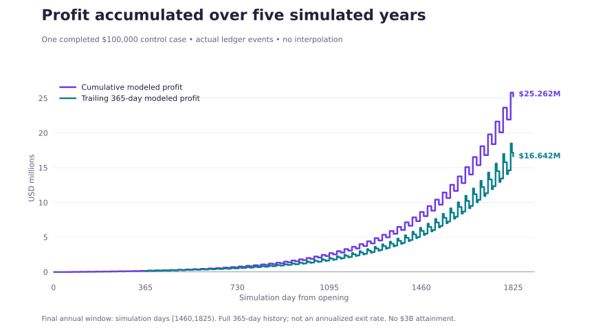
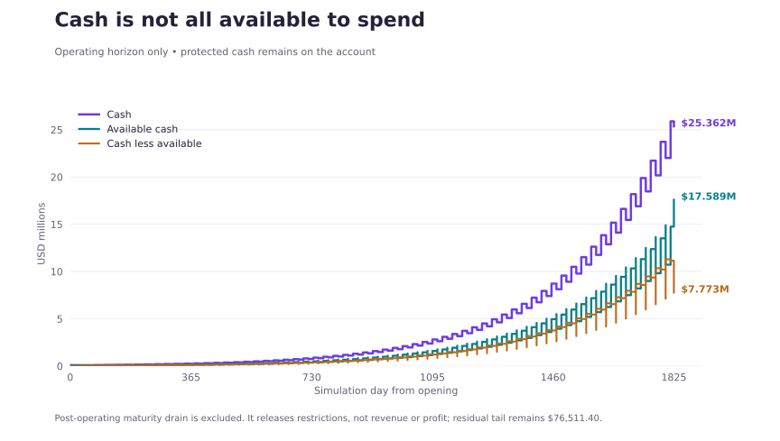
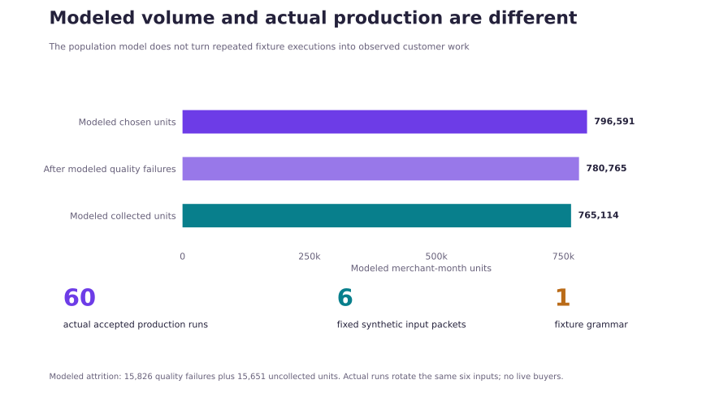
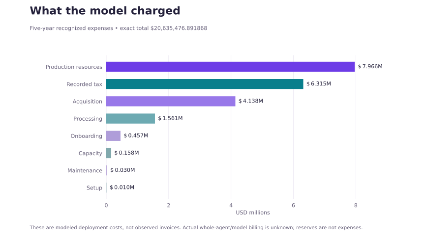

# Growth 067 interim report

## One profitable simulated control case, independently replayed

**Interim snapshot · 2 November 2026 · Selected completed case, not the entire campaign**

The `$100,000 / distribution_first / central` control completed a five-year simulated operating history. Independent replay reproduced its source identity, native account, operating checks, and complete **modeled** cost arithmetic. It ended with **$16.642 million trailing-365-day modeled profit** and **$25.262 million cumulative modeled profit**.

This is **not actual commerce, a Blue Sky breakthrough, the primary finite-game strategy, a best-case ranking, or a $3 billion result**. The broader 63-case campaign was still in progress at this report's evidence snapshot. This case is shown because its completed public artifact has been independently replayed, not because a completed campaign established it as the winner.

| At a glance | Result |
|---|---:|
| Simulated opening capital | $100,000 |
| Completed operating horizon | 1,825 simulation days |
| Final trailing-365-day profit | $16,641,713.166780 |
| Five-year cumulative profit | $25,261,803.108132 |
| Five-year recognized revenue | $45,897,280.00 |
| Five-year modeled expenses, including recorded tax | $20,635,476.891868 |
| Actual accepted production executions | 60, reusing **six fixed synthetic packets from one grammar** |
| Modeled collected merchant-month units | 765,114 |
| $3 billion annual-profit milestone | Not reached |

## Profit over time



The annual figure is the sum of recognized revenue less incurred modeled expenses in **native hours [35,040, 43,800)**, equivalent to simulation days **[1,460, 1,825)**. It covers a complete 365-day operating window, not an annualized exit month. Cumulative profit and annual profit are different measures and must not be added.

The chart uses 243 native account snapshots and 388 rolling-window snapshots derived from exact integer-microdollar records. All actions sharing an integer hour are treated together. A snapshot at integer hour *t* includes actions with hour less than *t*; changes therefore enter at *h + 1*, and leave the rolling window at *h + 8,761*. The plot uses steps, not interpolated or smoothed trajectories. The horizontal axis is simulated elapsed time, not calendar dates.

[Native series CSV](native-series.csv) · [Rolling-365 CSV](rolling365.csv) · [Full compact chart data](data.json)

## Cash and protected obligations



| Native account measure | Operating endpoint | After separate maturity drain |
|---|---:|---:|
| Cash | $25,361,803.108132 | $25,361,803.108132 |
| Available cash | $17,589,246.308132 | $25,285,291.708132 |
| Protected tail reserve | $7,772,556.80 | $76,511.40 |
| Cumulative profit | $25,261,803.108132 | $25,261,803.108132 |

The chart stops at the operating endpoint. Two later maturity actions remain in the same account but are excluded from the operating annual-profit window. Their release of restrictions **does not create revenue or profit**. The final residual reserve remains protected. These modeled terms do not guarantee coverage of arbitrary additional real-world claims.

The native funding record includes **110 earnings-funded acquisition/capacity spends totaling $4,289,046.043213**, plus five seed-funded growth spends totaling $7,324.751623. This establishes the recorded funding source for those simulated growth actions. It is not evidence of an invented scientific capability or an earnings-funded Blue Sky successor.

## What was actually produced



The executable service prepares a bounded merchant-month receivables-close packet: source-linked reconciliation, invoice open-item balances, balanced **draft-only** postings, unresolved exception handoff, management totals, and a source-grounded support response. It does not post to a live ledger, make payments, or establish whole-office or licensed accounting competence.

The **60 actual accepted production runs rotate six fixed synthetic input packets from one fixture grammar**. There are six distinct input hashes and six distinct output hashes. They are not 60 different customer jobs and do not establish a real-world population error rate.

The model separately records **796,591 chosen units**, **15,826 modeled quality failures**, and **15,651 uncollected units**, leaving **765,114 modeled collections**. Those bulk quantities were not individually rendered or independently observed buyer transactions. Their quality, collection, and demand behavior follows registered assumptions.

[Volume CSV](volume.csv) attributes eventually collected units to their **proposal/order cohort month**, not the cash-settlement month. The cash chart instead uses native settlement-event timing.

## Complete modeled cost reconciliation



| Cost category | Five-year modeled expense |
|---|---:|
| Production resources | $7,965,910.00 |
| Recorded tax | $6,315,450.777032 |
| Acquisition | $4,138,406.794836 |
| Processing | $1,560,555.32 |
| Onboarding | $456,690.00 |
| Capacity | $157,964.00 |
| Maintenance | $30,500.00 |
| Setup | $10,000.00 |
| **Total** | **$20,635,476.891868** |

Funded stage spending plus setup, processing, and recorded tax reconciles exactly to native expenses. Revenue minus these expenses equals **$25,261,803.108132**. Production resource cost is a **modeled $10 per chosen unit**, including failed or uncollected work; it is not a measured model bill. Actual whole-agent/model billing remains unknown. The modeled tax convention uses a 20% rate on cumulative positive pretax profit, net of prior tax paid; later losses do not refund prior tax. This is a simulation convention, not tax advice or an observed tax payment.

Reserved principal and cash restrictions are not counted again as expenses. “Complete” here means complete against the registered accounting and cost model, not an audit of an operating company's actual invoices or proof that every future deployment cost is known.

## What the result depends on

This is an **exogenous-rival-path control**. Its price choice optimizes a finite current-cohort contribution calculation under public priors; it is not the campaign's primary finite-game strategy or a globally optimal business.

Key central-world assumptions include:

- A modeled reachable stock of 3,197,817 firms, within a 6,395,635-firm population envelope. These are assumptions about addressability, not acquired customers or an order forecast.
- Monthly recurring work, a corrected single renewal mechanism, paid reactivation after a three-month cooldown, explicit three-month backlog expiry, and opt-outs.
- A $150 packet-value assumption; hypothetical $150 human-service, $100 hybrid, $79 rival, and $40 self-service comparison values at initialization. These are modeled buyer utilities and outside-option inputs, not verified market quotes.
- A 0.98 quality probability and 0.98 collection probability in the bulk model, plus a 15-day settlement delay and 45-day tail.
- An initial $2 lead cost with modeled saturation, 0.35 lead activation, $5 onboarding, $2 capacity setup per unit, and $500 monthly maintenance.
- An exogenous imitation path beginning at month 12 with a 0.8 rival-price factor. Rival strategy is not solved jointly with this control.

The actual fixture runs do not validate these demand or population assumptions. Other registered worlds, financing rules, and strategies can change or reverse the outcome. Their campaign-wide results are not established by this selected completed case. No live buyer demand, externally validated acquisition cost, commercial contract, actual collection, Blue Sky capability transfer, or $3 billion annual-profit attainment is established here.

The earlier 066 distribution-first policy exposed a real modeled failure: buying reach and capacity can leave too little cash to fulfill willing orders. The corrected experiment changes multiple mechanisms, so this report does **not** attribute the profit difference to any single correction without matched controls.

## Evidence and independent checks

**Independent replay: passed.** The reviewer matched 68 source-file hashes and the packaged result digest, then reran native, operating, and full-modeled-cost audits. A separate chart-data review recomputed all 243 account snapshots and all 388 rolling snapshots directly from event-prefix scans, checked the exact costs, and reconciled the volume counts and six repeated fixture identities.

- [Public run 41467872078](https://github.com/MontrealAI/AGI-Alpha-Invention-Flywheel-Lab/actions/runs/41467872078)
- [Public artifact 13157389058](https://github.com/MontrealAI/AGI-Alpha-Invention-Flywheel-Lab/actions/runs/41467872078/artifacts/13157389058) — artifact download may require GitHub sign-in and the artifact currently expires on 9 November 2026; this report and its compact data are browser-readable.
- [Durable exact public case ZIP](native-evidence/growth067-dev-100000-distribution_first.zip) · [Checksum, privacy scope, and public replay instructions](native-evidence/README.md)
- [Frozen executed source 8d615b1](https://github.com/MontrealAI/AGI-Alpha-Invention-Flywheel-Lab/tree/8d615b1e850f81838b7ff77f87fee8964bf1f280)
- [Frozen preregistration](https://github.com/MontrealAI/AGI-Alpha-Invention-Flywheel-Lab/blob/8d615b1e850f81838b7ff77f87fee8964bf1f280/growth067/PREREGISTRATION.json)
- [Public independent-result receipt](https://github.com/MontrealAI/AGI-Alpha-Invention-Flywheel-Lab/pull/142#issuecomment-6581992041)
- [Compact independent replay](independent-replay.json) · [Chart-data validation](VALIDATION.json)

| Identifier | Exact value |
|---|---|
| Case | `dev-100000-distribution_first` |
| Configuration | `central / seed 670001 / unit_cost 10 / capital_available` |
| Executed commit | `8d615b1e850f81838b7ff77f87fee8964bf1f280` |
| Preregistration SHA-256 | `4bfb47a46e5bbd676bfd2ad24eaff5630b20883dd5b438cbbd564d3c1e32a088` |
| Artifact ZIP SHA-256 | `f7415b3200eb0984961b6c17e7a90bf8ce1559559ebf3ec425bb025a43480c95` |
| Native actions SHA-256 | `837c47932100454ddbe45d7277efd91d9b8f36f950e642b485e575fa7a923e90` |

The later workflow-only repair head `c07d5f5ecc7d8e214a4f4d262cde3d1f41e9117a` is not the economic source executed for this case. Publication of this report does not rerun or alter the frozen campaign, make a merge claim, or convert the control into the flagship.

## Reproduce the figures

The committed chart data, replay receipt, and durable exact public ZIP preserve this selected case after the Actions artifact expires. Full canonical-account re-audit uses that ZIP plus the frozen public source; compact chart files alone are not a replacement for its complete event and source package. Verify the ZIP SHA-256 and follow the linked public replay instructions. The extraction script accepts that ZIP and the independently replayed compact receipt, uses standard-library integer accounting, and asserts the endpoint and cost reconciliation. Chart generation converts exact values to display coordinates only and uses step plots.

```sh
python3 extract_report_data.py --artifact /path/to/growth067-100k-distribution.zip --audit independent-replay.json --output /tmp/growth067-report-reproduction
python3 build_charts.py --data /tmp/growth067-report-reproduction/data.json --output /tmp/growth067-report-reproduction
```

Chart generation requires Matplotlib. Reading this report does not. All displayed figures are static; no tracking, API calls, live account access, or external messages occur. The portable [HTML report](index.html) is included as source for download or qualified later hosting; a GitHub file preview is not a separate deployed website.
