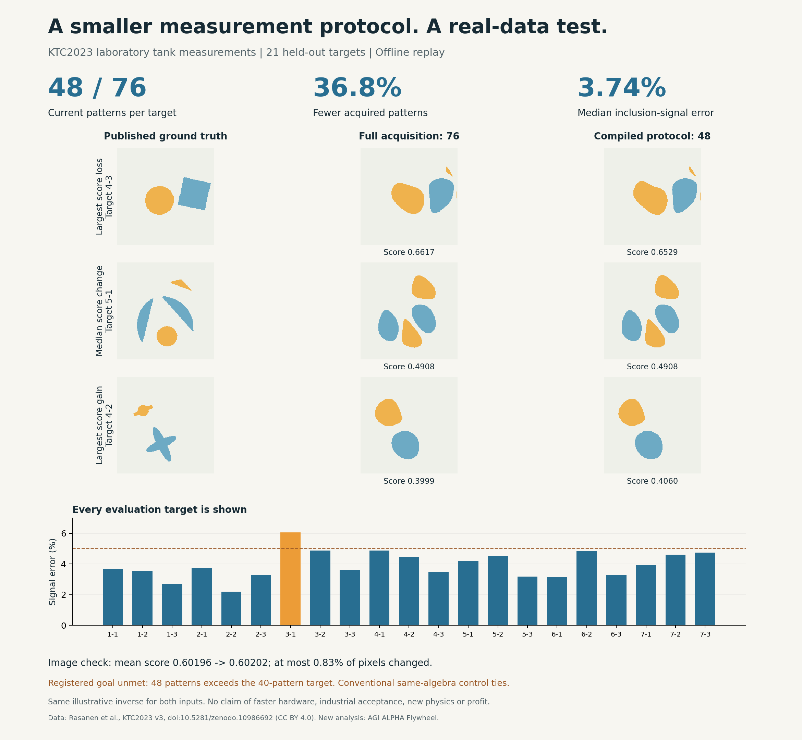

# Real-data measurement compilation: useful partial result, target unmet

An executable calibrated protocol recovered the measured boundary responses of
21 held-out physical tank targets using **48 of 76 current patterns** per target.
The median inclusion-signal error was **3.7402%**; 20/21 targets were below 5%,
and the worst was **6.0599%**. The count is **36.84% lower** than full acquisition.

**The registered objective remains REJECT:** it required at most 40 patterns.
The error conditions passed, but the acquisition condition did not. The study
does not claim a new market, hardware speedup, new physics, industrial acceptance,
superior general intelligence or profit.



## What was actually built

The compiler uses current geometry plus one response mode learned from a
homogeneous-tank calibration. It selects current patterns with established QR
factorization and greedy experimental design, compiles a reconstruction operator,
then fits fresh specimen responses from the selected observations. Actual acquired
values are preserved unchanged. Geometry and calibration identities bind reuse.

The underlying restriction was an incomplete model of the recorded response
space. The current matrix has rank 15; the homogeneous voltage data contains an
additional substantial mode. The model correction improves transfer in this
dataset, without identifying the physical origin of that mode. Reference data,
an acquired representation and a specimen-specific answer remain separate objects.

This is assistant-engineered code and a frozen offline experiment. It is not a
runtime LLM discovering unspecified instruments, an autonomous enterprise, or a
new experimental-design algorithm. The conventional same-algebra control matches
the candidate within 1.1e-15 maximum absolute voltage difference.

## Complete comparison on the same 21 targets

The candidate count and source were frozen before opening the evaluation archive.
No evaluation target was used to select the count, basis, tolerance or calibration.
All arms use the same supplied current/voltage geometry and homogeneous reference.

| Method | Patterns | Median signal error | Worst signal error | Targets <=5% |
|---|---:|---:|---:|---:|
| Calibrated physics plus one mode | 48 | 3.7402% | 6.0599% | 20/21 |
| Standard rank-16 reference SVD | 48 | 4.3082% | 6.3043% | 15/21 |
| Current-only model, candidate's exact pattern indices | 48 | 4.6290% | 6.5585% | 16/21 |
| Conventional adjacent-current basis | 15 | 15.1865% | 24.0079% | 0/21 |
| Full direct acquisition | 76 | 0% by definition | 0% by definition | 21/21 |

The adjacent arm uses fewer patterns and is not a matched-cost claim of superiority.
Full acquisition supplies the measurement reference, not noiseless physical truth.
The two matched 48-pattern controls are standard low-rank recovery and a structural
ablation. They do not exhaust competent experimental-design methods. The ordinary
same-algebra control prevents attributing this construction's benefit to AI alone.

## Does the recovered response preserve the image?

A separately labeled secondary check used the KTC authors' released illustrative
linearized inverse, unchanged priors and Otsu segmentation for both input sets.
It compared against the corrected v3 ground truths on all 21 targets.

| Image quantity | Observed result |
|---|---:|
| Mean published image score, full 76-pattern input | 0.601960 |
| Mean published image score, recovered 48-pattern input | 0.602023 |
| Largest per-target score decrease | 0.008746 |
| Largest changed fraction of image pixels | 0.8271% |

The tiny difference in mean score is not a demonstrated improvement. The images
show that the reduced input preserves this particular inverse's behavior closely;
both versions lose substantial shape information relative to ground truth. No
comparison against the best KTC reconstruction methods was executed, and no
industrial property or decision threshold was supplied by a customer. This
secondary check does not reverse the registered acquisition verdict.

Source-equivalent interpolation was checked against the original routine on 41
fixed coordinates. The published scoring formula was checked against the original
convolution calculation on a deterministic fixture before using equivalent FFT
convolution. The shared inverse setup was computed once for both arms. Caching
does not give the candidate a privilege withheld from the conventional comparator.

## Corrections, resources and retained learning

The original full-current-space assumption refused the training geometry: the
instrument measures 32 electrodes but injects through 16, spanning 15 directions.
The compiler now binds the actual excitation subspace and does not invent responses
outside it. Next, ideal-physics projection failed the signal criterion. One extra
calibration mode was prospectively registered. Unit tests caught an overrestrictive
rank guard. Recovery initially projected acquired values too; that implementation
was corrected to preserve observations. Earlier numerical results are retained as
superseded development results rather than favorable selections. The image wrapper
also needed one sparse-precision adapter correction before its successful run.

Seventeen boundary tests passed in normal and optimized Python. They include
independent coefficient-space arithmetic, a nonreciprocal failure, deficient
selection, out-of-scope excitation, calibration changes, preserved observations
and a new specimen mode that the retained basis cannot recover. These are locally
written tests, not external certification. Source hashes bind the frozen model;
`evidence/REPLAY.json` records standalone reproduction.

The physical-data confirmation took about 0.13 seconds locally after development;
the secondary image check took 33.19 seconds including about 4.87 seconds for its
inverse setup and cross-checks. These are scoped timings, not complete engineering
or business costs. Full source-specific telemetry is retained. The earlier wrapper
failure's complete cost and total assistant/host charges are unmeasured.

The hypothetical acquisition protocol needs **76 reference patterns per setup**,
plus 48 per new target. That calibration is not free. This study's verification
also uses every published target response. It does not demonstrate a future online
5% error certificate from only 48 values, proportional hardware-time savings,
fewer electrodes, lower hardware cost, or performance under motion and drift.

**Tried -> outcome -> lesson:** ideal input physics alone missed recorded response
structure; reference-informed recovery improved the result but did not meet the
40-pattern goal. Preserve measured observations, qualify transfer on new specimens,
and test the downstream property. A faithful copy of an imperfect reconstruction
is not an accepted internal-property measurement. The remaining enterprise gates
are specified in [ARRANGEMENT.md](ARRANGEMENT.md).

## Reproduce

Tested with Python 3.12.14, NumPy 2.3.5, SciPy 1.17.0 and Matplotlib 3.10.8.
The archives are 3.2 MB and 0.6 MB; hashes are checked before reading them.
No raw datasets, credentials, private documents or account state are bundled.
Run from the repository root; all output directories must be new.

```sh
python3 campaign/measurement-compiler-001/fetch_data.py --output /tmp/ktc-data
OPENBLAS_NUM_THREADS=1 python3 -m unittest research.measurement_compiler.test_core research.measurement_compiler.test_calibrated
OPENBLAS_NUM_THREADS=1 python3 -O -m unittest research.measurement_compiler.test_core research.measurement_compiler.test_calibrated
OPENBLAS_NUM_THREADS=1 python3 -m research.measurement_compiler.calibrated_run develop --data /tmp/ktc-data --output /tmp/ktc-development
OPENBLAS_NUM_THREADS=1 python3 -m research.measurement_compiler.calibrated_run confirm --data /tmp/ktc-data --freeze /tmp/ktc-development/development.json --output /tmp/ktc-confirmation
OPENBLAS_NUM_THREADS=1 MPLBACKEND=Agg python3 campaign/measurement-compiler-001/reconstruct.py --data /tmp/ktc-data --confirmation /tmp/ktc-confirmation/confirmation.json --output /tmp/ktc-images
python3 campaign/measurement-compiler-001/plot.py --confirmation /tmp/ktc-confirmation/confirmation.json --images /tmp/ktc-images --output /tmp/ktc-result.png
```

The expected primary verdict is **REJECT**, with 48 patterns, 21 targets and 20
within 5%. Reproduction passing means the recorded research result is reproduced;
it does not convert that verdict into enterprise qualification.

## Sources and rights

The measurement data, corrected ground truths and illustrative inverse are from
Rasanen, Kuusela, Jauhiainen, Arif, Scheel, Savolainen and Seppanen,
[KTC2023 v3](https://doi.org/10.5281/zenodo.10986692), CC BY 4.0. The
[dataset paper](https://www.aimsciences.org/article/doi/10.3934/ammc.2024009)
describes collection and strong competing reconstruction methods. Current-pattern
design has a substantial prior literature; see the primary sources in
[PROTOCOL.md](PROTOCOL.md). Public source access is not proof that this method is
novel or that a commercial unmet need exists.
