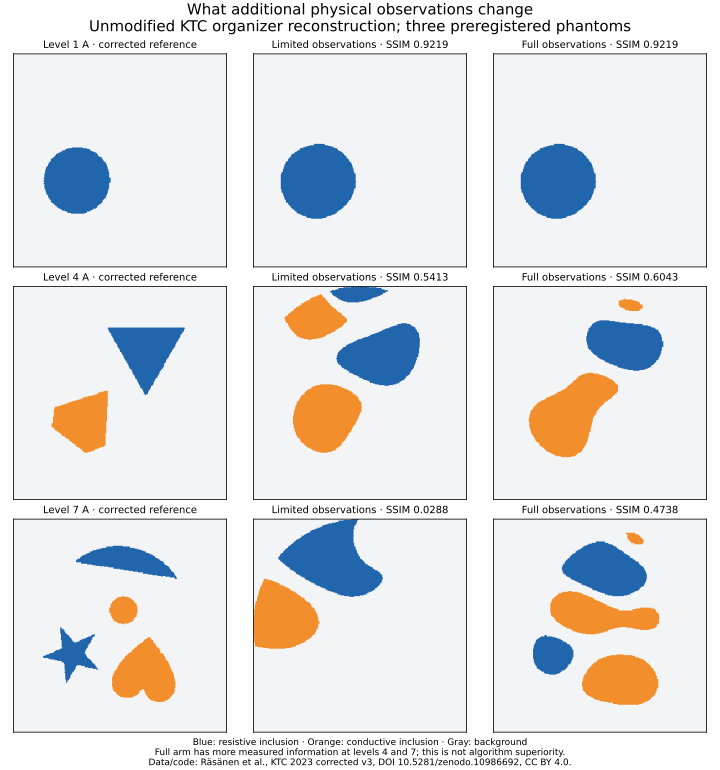

# Natural-workload continuation: KTC physical observations

This continuation executed the released KTC finite-element reconstruction on corrected, physically measured evaluation data. It also executed a stronger released reconstruction on the same limited observations. It does not establish a new physical instrument, autonomous opportunity invention, buyer acceptance, commercial profit or the full FLYWHEEL objective.

The frozen protocol was published in [PR #206](https://github.com/MontrealAI/AGI-Alpha-Invention-Flywheel-Lab/pull/206) at `2026-11-03T23:08:30Z`, before evaluation measurement/ground-truth values were inspected. Protocol SHA-256: `16904020e4c080b478c187534d02f21d9a3c940d55c39dd445c806ded386a958`. These publicly known challenge cases were held out from this construction; no historical secrecy or new population sample is claimed.

## What was executed

Corrected KTC v3, [DOI 10.5281/zenodo.10986692](https://zenodo.org/records/10986692), supplies real water-tank voltage measurements, corrected reference segmentations, a mesh and a conventional reconstruction. Exactly three frozen cases were selected: phantom A (`data1`) at levels 1, 4 and 7. Six organizer-code runs used each case's limited and full observation sets. No source or hyperparameter change was needed. A wrapper supplied paths and arguments; full-observation runs use category 1 so the code does not deliberately discard those additional measurements.

The primary contrast changes information as well as the reconstructed result. It tests an observation-coverage hypothesis, not superiority of a new algorithm. Common finite observations are exactly equal in the paired files; their corrected reference segmentations also match. Original file checksums, output arrays, code identities and measured execution times are retained in `RESULT.json`.

The further three runs used unchanged [CUQI3 source](https://github.com/CUQI-DTU/KTC2023-CUQI3/tree/c3a9465a3aeb5c2ced6c72aa357afa584fa9b9e7) with spatial regularization. These are explicitly exploratory stronger controls, introduced after the main protocol and not counted as extra confirmation. Despite a scikit-image listing in its requirements, CUQI3's actual executed path uses installed NumPy/SciPy/matplotlib; no package installation was necessary. FEniCS/Torch-dependent alternatives were inspected but not run, and superiority over them remains unknown.

## Results

Higher KTC score is better. It averages the resistive and conductive binary-image SSIM values; it is not a probability or an application-specific acceptance threshold. In level 1 A, the conductive class is absent, so classwise overlap and counts must accompany the aggregate score.

| Frozen case | Limited observations | Organizer / limited | Organizer / full (2,356 observations) | CUQI3 / limited, exploratory |
| --- | ---: | ---: | ---: | ---: |
| Level 1 A | 2,356 | 0.921925 | 0.921925 | 0.947534 |
| Level 4 A | 1,200 | 0.541295 | 0.604323 | 0.644968 |
| Level 7 A | 513 | 0.028828 | 0.473773 | 0.229329 |

**The registered all-three-strictly-improve hypothesis is rejected.** The protocol has a meaningful design flaw: level 1's two observation sets are identical, so deterministic strict improvement on that control is impossible. This condition is preserved, rather than quietly changed to two-of-three after seeing the results. The limited/full differences at levels 4 and 7 remain useful descriptive evidence, not a rescued confirmatory claim.

The stronger conventional control matters. At level 4, CUQI3 with 1,200 observations exceeds the organizer reconstruction with all 2,356. Extra sensing is therefore not established as the sole obstacle. At level 7, CUQI3 improves considerably over the organizer's limited result, while still trailing the organizer with full observations. That pattern motivates a matched comparison of stronger reconstruction and observation design; it does not certify an irreducible information limit.

No application-specific acceptable error, sensing cost, willingness to pay or source of commercial advantage was measured. These scores do not license a physical-property certificate or an autonomous sale.



## Independent evaluation and resource use

The original scorer uses direct convolution with a 321-by-321 Gaussian kernel. Two original full-size scoring calls were preserved. A separately implemented scorer exploits the exact separability of that same kernel, with unchanged zero padding, normalization, class masks, windows and constants. Its acceptance tolerance, `1e-10` absolute score and moment discrepancy, was registered before numerical comparisons. `original_score_validation.json` and `INDEPENDENT_SCORER_REVIEW.json` record independent original-code comparisons, deterministic edge cases, source/input hashes and qualification status. `summarize.py` refuses to assemble the final result unless that independent validation passes.

Every numerical process was limited to one BLAS/OpenMP thread from launch to avoid oversubscribing shared execution. Recorded CPU and wall times describe these executions, not human labor, invoice costs or scale economics. Actual development/model/host monetary costs remain unknown. There were no financial postings or real payments. The three baseline archive downloads total 4,226,908 bytes; stronger-control source acquisition is recorded separately by its manifest.

## Reproduce and interpret

Use an isolated directory with the files from this experiment and installed Python 3.12, NumPy 2.3.5, SciPy 1.17.0 and matplotlib. The original sources requested older package versions; successful execution here qualifies only this recorded environment. Run:

```sh
OPENBLAS_NUM_THREADS=1 OMP_NUM_THREADS=1 MPLBACKEND=Agg python reproduce.py
```

The runner downloads pinned public source/data, verifies SHA-256, executes the six frozen and three exploratory reconstructions, scores them, checks the original scorer and renders the figure. Direct original scoring is much slower than reconstruction or the validated separable evaluation. Interrupted work can be inspected through per-case receipts; rerunning reproduces these external diagnostic artifacts, never a native account or ledger. No default claim of arbitrary interruption-safe financial operation is attached to this runner.

A defensible next step is to freeze a real decision and acceptable error/cost before constructing its observational interface. First let capable released reconstruction methods resolve the same task; then test the residual with independently held-out measurements. The current work has moved that possibility from a literature suggestion to executed physical-data evidence, while leaving the required inventive and economic breakthrough unresolved.

Data and organizer code: Mikko Räsänen, Petri Kuusela, Jyrki Jauhiainen, Muhammad Arif, Kenneth Scheel, Tuomo Savolainen and Aku Seppänen, KTC 2023 corrected v3, CC BY 4.0. CUQI3: CUQI-DTU team, Apache 2.0 according to the pinned repository README. The source manifest retains URLs and hashes. Original datasets and source archives are reproducible public inputs, not copied into this repository evidence record.
