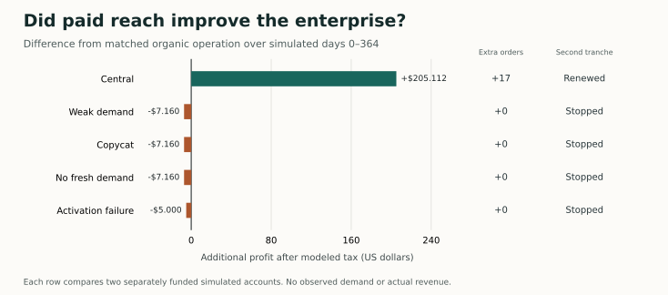

# Can collected earnings finance profitable paid reach?

Paid reach raised after-tax simulated profit in **1 of five** registered environments. Both profit and settled order volume increased in **1**. The seller bought a second tranche in **1**. Each comparison covers the complete simulated year from day 0 through day 364. Each account started with $100,000.

| Environment | Organic profit | Pilot profit | Pilot − organic | Additional settled orders | Highest modeled profit |
| --- | --- | --- | --- | --- | --- |
| Central | $262.792 | $467.904 | +$205.112 | +17 | Pilot |
| Weak demand | $147.088 | $139.928 | −$7.16 | +0 | Organic |
| Copycat | $147.088 | $139.928 | −$7.16 | +0 | Organic |
| No demand | $147.088 | $139.928 | −$7.16 | +0 | Organic |
| Failed activation | $262.792 | $257.792 | −$5.00 | +0 | Organic |

Paid reach reduced annual profit in Weak demand, Copycat, No demand, Failed activation. The nonentry comparator has zero revenue and zero costs. Each pair uses separate accounts and the same buyers, jobs, menu and organic contact schedule. The five environments have no empirical probability weights.

## What the seller knew before spending

All ten accounts reproduced the same 27 previously exposed opportunities before day 90. They each collected $285.95 on 19 accepted orders. The fresh cohort began afterward. The first purchase required liquid earned funds and a positive estimate under the preregistered assumption of two incremental orders. At renewal the seller credited only collections from buyers outside the complete organic roster, then deducted the entire first invoice and all first-plan variable costs.

| Environment | Day 90 | Earned cash before trial | First supplier state | Exclusive orders | Attributable pretax | Day 118 | Total invoices |
| --- | --- | --- | --- | --- | --- | --- | --- |
| Central | Funded trial | $197.06 | Expired | 7 | $86.09 | Funded renewal | $12.50 |
| Weak demand | Funded trial | $197.06 | Expired | 0 | −$8.95 | No exclusive collection | $6.25 |
| Copycat | Funded trial | $197.06 | Expired | 0 | −$8.95 | No exclusive collection | $6.25 |
| No demand | Funded trial | $197.06 | Expired | 0 | −$8.95 | No exclusive collection | $6.25 |
| Failed activation | Funded trial | $197.06 | Failed | 0 | −$6.25 | No exclusive collection | $6.25 |

The renewal rule used its own prior receipts. Capacity displaced by paid work can affect enterprise profit. The matched annual difference above measures that effect along with all other modeled changes. In the failed-activation environment the supplier shock was hidden at purchase.

Fresh contact, settlement and overlap counts

| Environment | Arm | Fresh contacts | Fresh orders | Fresh collections | Paid exposures | Same-day overlaps | Paid contacts to organic roster | Repeat buyers | Refunded orders |
| --- | --- | --- | --- | --- | --- | --- | --- | --- | --- |
| Central | Organic | 12 | 9 | $176.04 | 0 | 0 | 0 | 0 | 0 |
| Central | Pilot | 55 | 26 | $508.56 | 45 | 2 | 15 | 7 | 0 |
| Weak demand | Organic | 12 | 0 | $0.00 | 0 | 0 | 0 | 0 | 0 |
| Weak demand | Pilot | 39 | 0 | $0.00 | 27 | 0 | 8 | 0 | 0 |
| Copycat | Organic | 12 | 0 | $0.00 | 0 | 0 | 0 | 0 | 0 |
| Copycat | Pilot | 39 | 0 | $0.00 | 27 | 0 | 8 | 0 | 0 |
| No demand | Organic | 12 | 0 | $0.00 | 0 | 0 | 0 | 0 | 0 |
| No demand | Pilot | 39 | 0 | $0.00 | 27 | 0 | 8 | 0 | 0 |
| Failed activation | Organic | 12 | 9 | $176.04 | 0 | 0 | 0 | 0 | 0 |
| Failed activation | Pilot | 12 | 9 | $176.04 | 0 | 0 | 0 | 0 | 0 |

Annual income, costs and buyer refunds in US dollars

| Environment | Arm | Collected | Recognized revenue | Incurred expenses incl. tax | Expenses paid | Modeled tax | Buyer principal refunded | Profit |
| --- | --- | --- | --- | --- | --- | --- | --- | --- |
| Central | Organic | $461.99 | $461.99 | $199.198 | $199.198 | $65.698 | $0.00 | $262.792 |
| Central | Pilot | $794.51 | $794.51 | $326.606 | $326.606 | $116.976 | $0.00 | $467.904 |
| Weak demand | Organic | $285.95 | $285.95 | $138.862 | $138.862 | $36.772 | $0.00 | $147.088 |
| Weak demand | Pilot | $285.95 | $285.95 | $146.022 | $146.022 | $34.982 | $0.00 | $139.928 |
| Copycat | Organic | $285.95 | $285.95 | $138.862 | $138.862 | $36.772 | $0.00 | $147.088 |
| Copycat | Pilot | $285.95 | $285.95 | $146.022 | $146.022 | $34.982 | $0.00 | $139.928 |
| No demand | Organic | $285.95 | $285.95 | $138.862 | $138.862 | $36.772 | $0.00 | $147.088 |
| No demand | Pilot | $285.95 | $285.95 | $146.022 | $146.022 | $34.982 | $0.00 | $139.928 |
| Failed activation | Organic | $461.99 | $461.99 | $199.198 | $199.198 | $65.698 | $0.00 | $262.792 |
| Failed activation | Pilot | $461.99 | $461.99 | $204.198 | $204.198 | $64.448 | $0.00 | $257.792 |

Study and setup were expensed under the original $35 envelope. Annual maintenance was $12. Each purchased supplier tranche cost $6.25 including support. The 20% provision applies to positive modeled pretax income. Opening capital is financing. Refunded custody principal is reported separately from revenue and expenses.

Closing cash and obligations in US dollars

| Environment | Arm | Cash | Available | Unrestricted earned | Tail reserve | Payables | Restricted custody | Custody reserve | Reserved investment | Working capital |
| --- | --- | --- | --- | --- | --- | --- | --- | --- | --- | --- |
| Central | Organic | $100,262.792 | $99,791.202 | $262.792 | $471.59 | $0.00 | $0.00 | $0.00 | $0.00 | $0.00 |
| Central | Pilot | $100,467.904 | $99,656.994 | $467.904 | $810.91 | $0.00 | $0.00 | $0.00 | $0.00 | $0.00 |
| Weak demand | Organic | $100,147.088 | $99,855.138 | $147.088 | $291.95 | $0.00 | $0.00 | $0.00 | $0.00 | $0.00 |
| Weak demand | Pilot | $100,139.928 | $99,847.978 | $139.928 | $291.95 | $0.00 | $0.00 | $0.00 | $0.00 | $0.00 |
| Copycat | Organic | $100,147.088 | $99,855.138 | $147.088 | $291.95 | $0.00 | $0.00 | $0.00 | $0.00 | $0.00 |
| Copycat | Pilot | $100,139.928 | $99,847.978 | $139.928 | $291.95 | $0.00 | $0.00 | $0.00 | $0.00 | $0.00 |
| No demand | Organic | $100,147.088 | $99,855.138 | $147.088 | $291.95 | $0.00 | $0.00 | $0.00 | $0.00 | $0.00 |
| No demand | Pilot | $100,139.928 | $99,847.978 | $139.928 | $291.95 | $0.00 | $0.00 | $0.00 | $0.00 | $0.00 |
| Failed activation | Organic | $100,262.792 | $99,791.202 | $262.792 | $471.59 | $0.00 | $0.00 | $0.00 | $0.00 | $0.00 |
| Failed activation | Pilot | $100,257.792 | $99,786.202 | $257.792 | $471.59 | $0.00 | $0.00 | $0.00 | $0.00 | $0.00 |

## Scale and evidence boundary

The most profitable registered account earned **$467.904** (Central, pilot). Its gap to $3 billion was **$2,999,999,532.096**. The published budgets, voluntary choices and contact rights of the 27 warm buyers and 24 fresh prospects cap possible collections in this experiment at $2,054.21 even before costs. Demand, supplier reliability, retention, fees and unit costs are hypotheses. Actual commercial revenue was $0. The complete real costs of development, compute, support and acquisition remain unknown.

These are ten new independent simulation accounts. The earlier primary account, later engineering replays and any public-release operation have separate identities. The aggregate records independent audits for these ten accounts. A release or a run from downloaded bytes requires its own dated receipt.

Protocol commit `786d1d085f83c70ab8b7b9a3ee0c79530af7c79b` · execution source `9187e8f0b57d4b11124a14ed89582914f33b30b6` · runtime source-map SHA-256 `72ce9400200c8201a5c60bb7a299b9206cf00d0ae70fa2baf36433ff5ac49010`. [Preregistration](https://github.com/MontrealAI/AGI-Alpha-Invention-Flywheel-Lab/blob/786d1d085f83c70ab8b7b9a3ee0c79530af7c79b/campaign/omega-paid-reach-20261104/PROTOCOL.md) · [Execution source](https://github.com/MontrealAI/AGI-Alpha-Invention-Flywheel-Lab/tree/9187e8f0b57d4b11124a14ed89582914f33b30b6)

Aggregate SHA-256 `b646d9ec901f6c71ff6ebe2ee6717387b55f47aa9f60a623a2b2c16cfc3acbcb` · comparison program SHA-256 `3daf2c05535c9bee7e857dbe40a3ade9be3deed17c27b0532df3e68c21a52c00`. [Ten audited accounts and machine-readable comparison](./PAIRED_EVIDENCE.json)

[Decision limits and scale bound](DECISION_LIMITS.md) · [Reproduce the ten-account study](REPLAY.md) · [Independent ledger replay](review/INDEPENDENT_LEDGER_AUDIT.json) · [Aggregate cross-check](review/CROSSCHECK.json) · [Recovery after interruption](review/MATRIX_RECOVERY.json).
