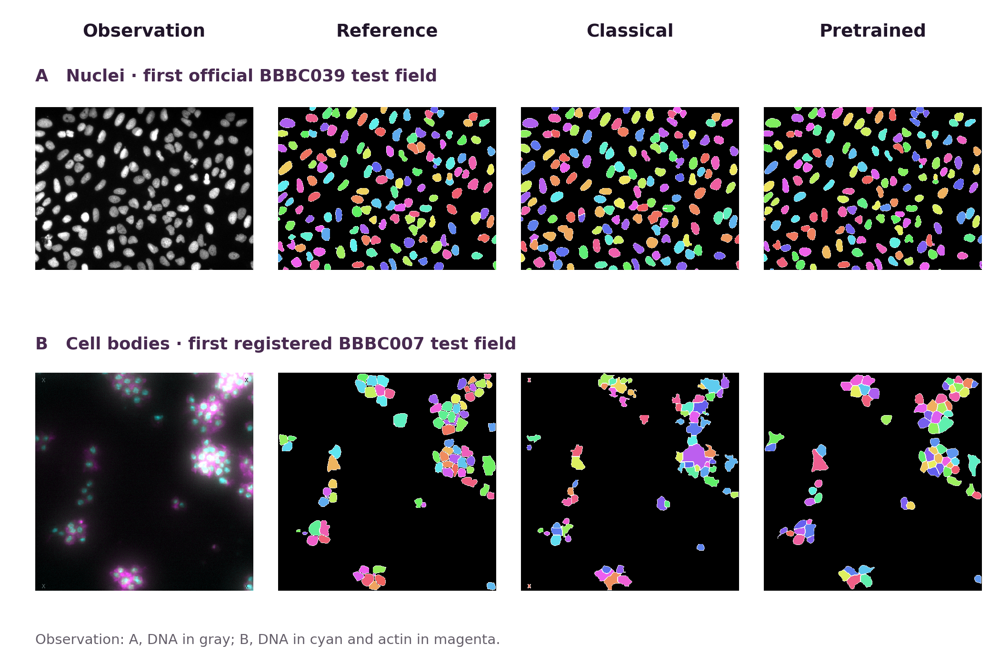

# 🏗️♾️ LEARNING TO BUILD ✨

## How Intelligence Learns to Create What Makes New Possibilities Real

**Vincent Boucher · MONTREAL.AI / QUEBEC.AI**  
7 November 2026 · Research edition **1.1.0**

> Build an ability worth having. Then test whether the experience makes you better at building a different one.

A useful idea can remain out of reach because the necessary knowledge, instruments, processes, resources and arrangements do not yet work together. Learning to build concerns the construction of that complete route, followed by a fair test of what transfers to the next construction.

This is a **separate, versioned continuation**. The [published 1.0.0 edition](https://github.com/MontrealAI/AGI-Alpha-Invention-Flywheel-Lab/releases/tag/learning-to-build-v1.0.0), its source tree and its original evidence remain unchanged.

**Measured outcome:** the fixed pretrained nucleus route meets every source research gate on both cohorts. Its whole-cell successor fails the boundary requirement. The six classical successor arms exhaust the shared recipe bank and tie; no accepted construction-method advantage is established.

## Choose a starting point

| Your purpose | Start here |
| --- | --- |
| Understand the idea and its limits | [Illustrated reader](https://montrealai.github.io/AGI-Alpha-Invention-Flywheel-Lab/learning-to-build-v1.1.0.html) or [complete PDF](LEARNING_TO_BUILD.pdf) |
| See the useful outcome and exact acceptance contract | [Practical construction brief](construction/CONSTRUCTION_BRIEF.md) |
| Operate or reproduce the microscopy instrument | [Setup, operation and recovery guide](construction/README.md) |
| Assess the measured results and adverse cases | [Complete continuation results](construction/RESULTS.md) and [machine-readable report](construction/RESULTS.json) |
| Inspect or extend the research design | [Effective classical protocol](construction/PROTOCOL-amendment-2.json), [specialist protocol](construction/INCUMBENT_PROTOCOL-amendment-2.json), and [research programme](sections/programme.tex) |
| Download an identified edition | [Release](https://github.com/MontrealAI/AGI-Alpha-Invention-Flywheel-Lab/releases/tag/learning-to-build-v1.1.0) and [editable source package](https://github.com/MontrealAI/AGI-Alpha-Invention-Flywheel-Lab/releases/download/learning-to-build-v1.1.0/LEARNING_TO_BUILD_SOURCE.zip) |

After the downloaded-release reproduction and raw-image operation pass, the release receives an [operation receipt](https://github.com/MontrealAI/AGI-Alpha-Invention-Flywheel-Lab/releases/download/learning-to-build-v1.1.0/OPERATION_RECEIPT.json). That receipt records operation of the released package; scientific qualification remains a separate verdict.

## The contribution

The proposed contribution is a **connection between an operational representation and a test of learning**. A construction witness joins an executable policy to dependencies and interfaces, a resource schedule, authority and participation, claim-linked evidence, and continuing obligations. It makes the route from a changed formulation to an accepted ability inspectable.

The paper distinguishes the **installed frontier**, what current means can deliver, from the **construction frontier**, what an admissible construction path could make deliverable. It makes three consequences explicit:

1. A route must be feasible at each step. A favorable final balance cannot repair a missing prerequisite, unavailable permission or liquidity shortfall earlier in the sequence.
2. Retained means can create valuable options and continuing obligations. Maintenance can make the set of worthwhile successors smaller.
3. A useful artifact does not establish a better constructor. A revised construction method must be compared with a competent ordinary method given the same legitimate information and resources.

Systems engineering, program and library learning, transfer, and economic complementarity already supply important parts of this account. The paper engages them as foundations and alternatives. Bioimage workflow evaluation also has direct precedents: [BIABench](https://github.com/BIABench/BIABench) evaluates complete agent analyses across tasks drawn from published studies. This continuation instead tests a specific ordering update in a supplied recipe bank and separately operates one specialist; it does not claim a new general bioimage-agent benchmark. Its elementary formal results are conditional consequences of stated assumptions, not a new general optimization algorithm or a priority claim over those fields.

The research direction connects three existing papers:

| Foundation | What it contributes to this question |
| --- | --- |
| [Transformational Intelligence](https://montrealai.github.io/AGI-Alpha-Invention-Flywheel-Lab/transformational-intelligence.html) | Separate the authorized purpose from an inherited formulation; construct a better route and connect it back to that purpose. |
| [Invent the Economy](https://montrealai.github.io/AGI-Alpha-Invention-Flywheel-Lab/invent-the-economy.html) | Treat productive methods, voluntary participation, prices, risk and the timing of funding as a joint construction problem. |
| [ALPHA GENESIS FLYWHEEL Ω, research edition 2.0](https://montrealai.github.io/AGI-Alpha-Invention-Flywheel-Lab/alpha-genesis-flywheel-omega-v2.html) | Connect discoveries to useful constructions and demonstrated successor benefits; distinguish a useful inventory from an improved discovery process. |

## What changes in 1.1.0

The first edition's finite computational illustration is preserved: four emitted measurement programs, 4,000 input cases, 288 authored resource scenarios, and a conventional equal-content tie. The copied `study/` companion retains that exact authored study for convenient reproduction; the original publication remains its source.

The new construction concerns **reproducible offline microscopy measurements**. The first instrument produces nucleus instance masks, counts and segmentation-derived pixel areas on BBBC039v1. The successor requests whole-cell instances from DNA and actin in BBBC007v1. Nucleus masks alone do not supply cell-body boundaries.

Six separately executed classical arms share the same 24 recipes and calibration resources. The primary contrast is a donor-derived greedy-coverage ordering against conventional empirical ranking over the identical donor table. A fixed order, ordinary donor reuse, updated construction with a retained artifact, and full enumeration complete the comparison. All arms may search all 24 candidates. This tests an ordering parameter of a supplied constructor, not autonomous discovery of segmentation operators.

A separately registered **CellposeDINO `cpdino-vitb`** route tests a strong practical alternative with additional pretrained stock. It is outside the equal-content primary comparison and is not evidence that the local constructor learned the specialist's competence. It uses the pinned model and inference configuration without local fine-tuning. Potential pretraining overlap with the public data is unknown.

### Practical specialist: source qualified, successor unqualified

The fixed pretrained **CellposeDINO** route meets the instance F1, foreground Dice and count-error gates on both official source cohorts. It is **qualified for the declared nucleus research contract**. This is a useful integration of an existing specialist; it is not competence learned by the local constructor, external laboratory acceptance, or validation of biological area measurements.

| Specialist cohort | Fields | Primary F1 | Foreground Dice | Relative count error | Verdict |
| --- | ---: | ---: | ---: | ---: | --- |
| Nuclei · validation | 50 | 0.953878 | 0.967388 | 0.066573 | Passes all source gates |
| Nuclei · test | 50 | 0.949103 | 0.967232 | 0.070837 | Passes all source gates |
| Cells · calibration | 4 | **0.386561** | 0.860566 | 0.130928 | Fails boundary F1 ≥ 0.60 |
| Cells · test | 12 | **0.505568** | 0.886682 | 0.200904 | Fails boundary F1 ≥ 0.60 |

Primary F1 is **instance F1 for nuclei** and **internal-boundary F1 for cells**. Values are field means rounded to six decimals. The specialist's whole-cell route meets the foreground and count gates but misses the boundary gate on both calibration and test. It remains **unqualified for the successor contract**. On the test fields, its boundary F1 is higher than the selected classical recipe's, while its count error is also higher.

The completed 116-field session records **4,969.507 CPU seconds** and **4,970.035 wall seconds**. These execution measurements exclude dependency setup, acquisition, independent checking, authoring, upstream pretraining, unavailable historical work and economic costs. The specialist was selected after classical source outcomes and registered before its own inference; possible pretraining overlap with these public images is unknown. The results do not establish unseen-data generalization.

### Measured classical results

The selected classical nucleus recipe, **`r17`, does not qualify**. It passes all three gates on the 50-field test cohort but misses the validation count-error gate; source acceptance requires both cohorts.

| Source cohort | Fields | Mean instance F1 | Mean foreground Dice | Mean relative count error | Verdict |
| --- | ---: | ---: | ---: | ---: | --- |
| Validation | 50 | 0.884357 | 0.910637 | **0.216173** | Fails count error ≤ 0.20 |
| Test | 50 | 0.897397 | 0.931317 | 0.088311 | Passes all three gates |

Every successor arm executes **all 24 recipes**, amounting to **96 calibration recipe–field evaluations per arm**, and selects **`r12`**. All six fail the cell-boundary requirement on both calibration and test. Every successor field has reference internal boundaries, so the all-field and boundary-bearing-field means coincide.

| Whole-cell cohort | Fields | Mean boundary F1 | Mean foreground Dice | Mean relative count error | Verdict |
| --- | ---: | ---: | ---: | ---: | --- |
| Calibration | 4 | **0.250398** | 0.850357 | 0.086298 | Fails boundary F1 ≥ 0.60 |
| Test | 12 | **0.309897** | 0.861007 | 0.104715 | Fails boundary F1 ≥ 0.60 |

The primary greedy-coverage versus same-content empirical comparison saves **zero candidate executions**. The arms tie in selected instrument, quality and candidate count; neither qualifies. Per-arm timings remain separately reported. This is an observed tie on one exposed comparison, not statistical equivalence over a population of construction tasks or a claim that ordering can never help elsewhere.

The unchanged donor artifact scores boundary F1 **0.072995** on the successor test fields and is unqualified. A labelled diagnostic that supplies **manual nuclei and foreground** to `r12` reaches boundary F1 **0.671256**, Dice **0.999933**, and count error **0.159935**. Those privileged inputs are not available to the primary raw-channel instruments. The diagnostic is not a deployable solution or complete raw-channel qualification. It motivates testing how reliable seed and foreground means can be constructed; it does not identify which input is decisive because both change together.

The completed classical phases record **696.935 CPU seconds** and **696.703 wall seconds**. These are measured run-stage totals, including donor work and diagnostics, and exclude setup, acquisition, independent verification, authoring, unavailable historical costs and economic costs. Exact unrounded scores and the detailed cost boundaries are retained in the [measured report](construction/RESULTS.json).

### Inspect the actual outputs

[](construction/figures/protocol-first-fields.png)

The first official BBBC039 test field and first registered BBBC007 test field were selected by order, without using their scores. Full fields are shown without cropping. Each observation channel uses first-to-ninety-ninth-percentile linear contrast **for display only**. Instance colors distinguish objects within a panel; they do **not** imply matching identities across panels. The registered reference and border conventions apply. These two examples illustrate the outputs; complete cohort measurements determine qualification. [Open the full-size image](construction/figures/protocol-first-fields.png) or inspect its [field identities, hashes and display receipt](construction/figures/protocol-first-fields.json).

### Keep the verdicts separate

| Claim | Required evidence |
| --- | --- |
| Useful first construction | An operable instrument meets every declared source acceptance gate. |
| Accepted successor | The different instrument meets its own calibration and test gates, including internal cell boundaries. |
| Better constructor | Accepted functionality and lower construction work against the same-content conventional method, with the full cost boundary visible. |
| Better learning rule | Repeated improvement across independently initialized development and confirmation campaigns. |
| Earned continuation | Actual accepted exchange and usable receipts or an executed funding arrangement. |

The [measured report](construction/RESULTS.md) gives the actual verdict for each claim. A failed successor remains a failure even when other diagnostics are favorable. A tie remains a tie. A successfully integrated specialist can be useful without constituting a newly invented segmentation method.

## What the follow-up diagnostics established

The six policies used four distinct orders. A frozen control-flow replay tested 33 order/settings interventions (30 unique orders); every one exhausted all 24 candidates and selected `r12`. All original per-recipe prediction hashes and scientific scores agreed across arms. The convergence is explained by the shared bank containing no acceptable candidate and the common fallback selector. The replay uses cached scores; it is not new image inference or independent language-model agreement.

A separate fixed-`r12` component experiment used only the four already exposed calibration fields:

| Input intervention | Boundary F1 | Meaning |
| --- | ---: | --- |
| Raw DNA and raw actin baseline | 0.250398 | Fails the boundary gate |
| Reference nuclei only | 0.195353 | Fails; worse on this cohort |
| Reference foreground only | 0.615828 | Passes numerical calibration gates with privileged input |
| Reference nuclei and foreground | 0.714909 | Passes numerical calibration gates with privileged inputs |

Foreground recovery is the better next lead within this implementation. The raw-foreground branch also unions its mask with the supplied seeds, so the interventions are not isolated biological causal effects. Reference-assisted success does not qualify a raw-input method. All sixteen component masks were scored through separate implementations; eight producer-control segmentations were also executed and charged. [Registration, complete evidence and replay commands](construction/diagnostics/README.md) preserve the actual call paths and limitations.

The initial diagnostic measured 8.465 CPU seconds and 7.058 wall seconds; its separate verification measured 8.896 CPU seconds and 7.278 wall seconds. These are additional process boundaries, not components to add again to the original classical stages. No fresh learning advantage or complete-cost saving is established.

### One practical repair was built, tested and stopped

The foreground diagnostic suggested an ordinary composition using existing means: the pinned specialist's final whole-cell mask union as foreground for the unchanged `r12` DNA-seeded watershed. This single candidate was frozen before scoring and actually composed the four retained specialist calibration outputs. It obtained boundary F1 **0.296809**, Dice **0.861057**, and count error **0.081112**. The boundary criterion still failed, and the unchanged specialist's calibration F1 was higher (**0.386561**).

The registered stop rule therefore halted the candidate with **zero test fields scored**, no tuning and no new neural inference. Its code includes a raw-input command, but an unexecuted complete raw-input run is not asserted as an outcome. The measured new composition/check work was **3.263 CPU seconds** and **1.755 wall seconds**. Original specialist constituent inference is attributed explicitly and not charged twice. [The failed repair, frozen registration and reproduction commands](construction/repair/README.md) preserve what was executed and what was not.

## Evidence and provenance

The continuation preserves the published preregistration lineage at commit [`64d6d30`](https://github.com/MontrealAI/AGI-Alpha-Invention-Flywheel-Lab/commit/64d6d30da4a5da7c8905d9a106d9e2a996a29e4d), including two narrow, documented representation amendments and the separately registered specialist.

This edition reports a **new reproduction of that already exposed comparison**. The earlier final raw-output package was not available for byte verification. It is not claimed as recovered evidence. New output masks, measurement records, timings and source-separated checks support the current results. The public source and compact historical failure records support the design lineage. Known earlier summaries mean that this execution is not a new blinded confirmation.

The raw classical tree contained 416 files and failed the strict file-set check. The publication projection retains 278 canonical files unchanged; all 138 byte-identical residual attempt-file copies and their reconstruction mapping are also preserved. Their cause is unknown. No reported metrics or costs changed. Appendix C and the construction guide document this distinction.

The retained ledger records three completed stages and no interrupted or orphaned attempt. That ledger flag does not prove that no work was omitted. The residual bytes could have arisen from copying or additional execution; any associated unrecorded work and cost remain unknown. The measured classical stage total is not asserted to capture all classical execution.

The five public compressed input archives total **87,775,682 bytes**. The acquisition record identifies their exact hashes. The specialist weights add **343,599,997 bytes**, plus the declared software dependencies. Dataset and model acquisition, execution, checking, failed work and other available receipts retain their own cost boundaries. Missing historical costs, total authoring effort, upstream pretraining and included model/host billing are **unknown, not zero**.

No laboratory was recruited. Acceptance thresholds are author-defined research criteria. Areas are pixel estimates derived from segmentation, not validated physical or biological measurements. The recorded work establishes no customers, commercial receipts, clinical utility, independent institutional validation or physical productive expansion.

The datasets, Cellpose code, model metadata, training-data terms and DINOv3 terms are separate rights questions. The specialist's recorded scope is research operation; commercial entitlement is not established. External data, upstream source and weights are acquired separately rather than redistributed as part of this publication.

### Runtime reproducibility

Use a dedicated environment with the **exact registered Python and package versions**, verified source identities and pinned model bytes. The reported local reproduction used Python **3.12.14** in a virtual environment with **`--system-site-packages` enabled**. It therefore was not fully isolated. Registered versions and upstream Python hashes are checked, but the work does not claim to freeze every transitive binary, compiler, operating-system component or processor implementation. The setup receipts preserve the actual environment configuration. The default isolated installer was checked separately; it did not replace the environment that produced the reported 116-field run.

## Reproduce the preserved finite study

After extracting the source package, run these commands from its root. Requirements: Python 3.10 or later. This companion uses only the standard library.

```sh
python3 -B study/check.py
python3 -B study/test_integrity.py -v
python3 -O -B study/test_integrity.py -v

python3 -B study/study.py --output /absolute/new/finite-replay
python3 -B study/check.py --evidence /absolute/new/finite-replay
```

Choose a new output directory. The study's correctness checks do not establish microscopy qualification. For microscopy, use the [construction guide](construction/README.md), which distinguishes checking retained evidence from acquiring the pinned dependencies and running new inference.

## Rebuild the manuscript

A normal TeX Live installation needs `pdflatex`, BibTeX and the packages declared in `LEARNING_TO_BUILD.tex`. The build runs in a clean directory with shell escape disabled.

```sh
python3 -B build.py --output /absolute/new/LEARNING_TO_BUILD.pdf
python3 -B verify.py --check-build /absolute/new/LEARNING_TO_BUILD.pdf
```

The canonical PDF is bound to its source in `PUBLICATION.json`. Recompilation in a different TeX distribution can change PDF bytes while retaining the content. Verification does not rewrite the recorded publication binding. Packaging and publication are separate operations from scientific qualification.

The microscopy comparison figure is regenerated separately by `construction/figures.py`, using the exact numeric environment plus `construction/requirements-figures.txt`. Supply the public data cache and both completed reproduction trees; `--help` gives the command. The script fixes the first field in each declared test order, verifies source and mask identities, and writes a provenance receipt. Its percentile contrast and categorical instance colors affect display only. No inference or scoring is performed by the figure script.

## A practical next contribution

Start with an authorized outcome and the strongest complete existing route. If that route already works, adoption can be the correct result. If it does not, identify the exact missing observation, interface, algorithm, resource or arrangement and the smallest construction that would resolve it.

The [original BBBC007 protocol](https://bbbc.broadinstitute.org/BBBC007) permits manual seed nuclei and foreground for its boundary-focused comparison. Its historical proximity percentage is a different metric from the symmetric F1 used here; the numbers are not a head-to-head comparison.

For the microscopy continuation, exhausting a candidate bank identifies the limits of that bank. Another ordering cannot create a missing boundary-recovery method. A new representation, observation or algorithm should be frozen before a new confirmation cohort is exposed, compared with strong complete alternatives, and charged for its acquisition and upkeep.

Researchers can contribute an independent checker or a genuinely new construction task. Builders can make the operating contract more useful without changing its evidence. Domain collaborators can contribute an authorized requirement or reference cohort with a decisive acceptance question. None of these possibilities implies an existing partnership, agreement or funding commitment.

## Citation

```bibtex
@techreport{boucher2026learningtobuild11,
  author      = {Boucher, Vincent},
  title       = {Learning to Build: How Intelligence Learns to Create
                 What Makes New Possibilities Real},
  institution = {MONTREAL.AI and QUEBEC.AI},
  year        = {2026},
  month       = nov,
  note        = {Research edition 1.1.0},
  url         = {https://montrealai.github.io/AGI-Alpha-Invention-Flywheel-Lab/learning-to-build-v1.1.0.html}
}
```

[CITATION.cff](CITATION.cff) supplies machine-readable attribution. The [French overview](https://montrealai.github.io/AGI-Alpha-Invention-Flywheel-Lab/learning-to-build-v1.1.0.html#francais) introduces the idea; the complete manuscript is in English.
