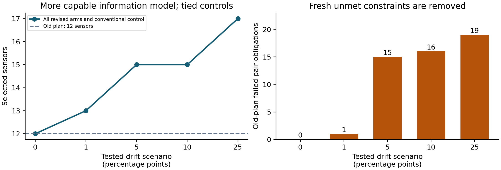

## Abstract

We construct and execute an observation-plan compiler that converts a reproduced information obstruction into a calibrated measurement program, then extends its retained rule to fresh work with bounded time-varying drift. On a source-pinned nine-source EPA model, a same-sensor reference removes an all-sensor uncalibrated ambiguity; a four-sensor plan survives every permitted erasure and passes 72 of 72 protected independent and actual-runtime cases. A separately declared 92-source numerical edition satisfies 108,836 pair/outage obligations while preserving its original raw range failure. On a prospectively frozen, previously uninspected 35-source model, drift-aware plans remove old-plan failures at all four nonzero declared drift bounds; 700 distinct latent worlds yield 2,100 successful matched-arm runtime evaluations. Retention, equal-content ordinary reuse, reset and conventional controls tie, so discovery superiority is not established. An artifact-bound simulated exchange and six frozen cashflow scenarios are executed. The base scenario yields CAD2,057.81 modeled profit and CAD1,557.81 conditional earned cash, but offer-specific demand, actual inference usage and complete costs remain unqualified. Qualified unrestricted earnings are zero, and the useful successor is research-funded. The result is verified finite-model technical enablement and reproducible conditional economics; the connected earned-funded commercial mission is incomplete.

**Evidence categories:** executed construction; procedurally independent verification; modeled economics; no actual commerce. **Scientific evidence source:** `b0d828309f14ef4dc278dc522739df85db43c460`. **Date:** 30 October 2026.


## Objective and evidence standard

The civilization-scale objective is to make difficult discovery work executable by a machine that can recognize missing information, construct an instrument that supplies it, verify a useful delivery, and use earned surplus to finance the next instrument. This campaign implements a small, inspectable instance of the first part: **a compiler for calibrated, failure-tolerant source-identification measurement plans**. It also executes an artifact-bound commercial simulation. It does not infer the larger mission from a working compiler, a positive authored cashflow, or publication.

The beneficiary is a utility modeling team or consultancy preparing an auditable observation plan. The complete executed delivery is a numerical model, an executable plan, explicit ambiguity witnesses, an outage certificate, source identities and a verifier receipt. A future physical service would additionally require calibrated instruments, suitable reference samples, measured drift, registration, maintenance, engineering review and an operational service obligation. Those tasks have not been performed or priced as if they were eliminated. No emergency water-safety decision is authorized by these simulated examples.

The important constraint is informational. If two source hypotheses can produce exactly the same readings under the allowed nuisance parameters, selecting a subset of those readings cannot identify the source. This is the same logical obstruction that defeated the earlier all-view XCT formulation: further search inside an information-insufficient family does not create information. Here the construction changes the available measurement by adding a same-sensor reference with a known signal, then tests whether that change removes the obstruction while preserving noise, cohort and outage requirements.

The resulting formal capability is reusable across model-based observation-design tasks. Its practical range remains conditional on the signal model and justified reference assumptions. No market-size narrative, field impact, scientific novelty or beyond-human foresight is inferred from this transfer path.

## Opportunity selection and existing alternatives

Three materially different possibilities were investigated before selection. Their detailed source docket and falsifiers are preserved in [OPPORTUNITIES.md](https://github.com/MontrealAI/AGI-Alpha-Invention-Flywheel-Lab/blob/b0d828309f14ef4dc278dc522739df85db43c460/campaign/next-009/OPPORTUNITIES.md).

| Possibility | Important unavailable outcome | Missing means and decisive constraint | Selection |
|---|---|---|---|
| Water-network observation planning | Identify modeled source hypotheses despite offsets and failed sensors | Additional valid information is needed when all existing channels admit the same two truths; executable public models and exact controls are available | Construct a bounded instrument |
| Metabolic flux measurement | Identify internal fluxes well enough to change production pathways | External fluxes underdetermine internal behavior; isotope measurements and established optimal-design methods must be included | Do not repeat an existing SBML lane; physical new measurements unavailable |
| Active spectral mixture identification | Identify constituents from scarce measurements | Library gaps, instrument mismatch and confounded spectra require calibrated discriminatory measurements; active wavelength methods already exist | No qualified calibrated data and complete baseline within this allocation |

The search is bounded. It includes government and laboratory software, executable examples and relevant primary methods; it is not proof that every imaginable alternative fails. Relevant water alternatives include EPA EPANET/WNTR, Sandia Chama, source inversion, minimum test cover, robust sensor placement and ordinary calibration. The initial executable probe reproduced the Sandia example's three-sensor mean-detection objective: sensors 12, 23 and 32, mean 7,600 seconds across the relevant source cases. An idealized two-sensor identification problem was already solvable by ordinary exhaustive selection. These results reject an unearned algorithmic novelty claim and make calibrated conventional optimization a required control.

The first construction therefore asks a functional question: can an auditable system turn a reproduced ambiguity into a new valid observation program? It does not ask whether it can rename familiar calibration or multicover mathematics. The model is source-pinned to [USEPA/WNTR commit 11eec7d5](https://github.com/USEPA/WNTR/tree/11eec7d5bf0a9367ffe04d75707918f0c0a890a1). Prior art includes [Sandia's executable example](https://github.com/sandialabs/chama/blob/main/examples/water_network_example.py) and [minimum-test-cover sensor placement](https://arxiv.org/abs/1507.07134). Matched service times, an independently constructed frontier-AI competitor and calibrated physical outcomes remain residual comparisons, not assumed failures.

## Signal model, complete cohort and acceptance rule

Let $s^a_{kt}$ be the source-contribution percentage predicted for source hypothesis $a$, sensor $k$ and time $t$. Each corpus includes every junction as a source and candidate sensor and every hourly timestamp in the declared first 24 hours. The simulator uses EPANET TRACE through the pinned official Linux library. The authored 24-hour horizon is recorded alongside the upstream model's native duration; it is not represented as a field contamination event.

For the primary model, an uncalibrated observation is

$$y_{kt}=s^a_{kt}+b_k+u_{kt},\qquad |u_{kt}|\leq\epsilon,$$

where $b_k$ is an arbitrary offset constant across the reference and trace. A known-zero reference is

$$r_k=b_k+w_k,\qquad |w_k|\leq\epsilon.$$

The generated readout is $z_{kt}=y_{kt}-r_k$. Its reference error $w_k$ is shared over time. Treating that error as independently resampled at every timestamp would change the feasible observation set; both compiler and separate checker instead preserve the common variable.

For two hypotheses, define $d_t=s^a_{kt}-s^b_{kt}$. Without the reference, their readings at one sensor can coincide if and only if

$$\max_t d_t-\min_t d_t\leq4\epsilon.$$

With a reference and bounded arbitrary reference-to-sample drift $D$, the two corrected traces are compatible if and only if

$$[-2\epsilon,2\epsilon]\ \cap\ \bigcap_t[d_t-2(\epsilon+D),\ d_t+2(\epsilon+D)]\neq\varnothing.$$

This follows by taking the difference of the two latent reference errors as one shared variable, while differences of sample errors and drift lie in the stated intervals. The primary construction fixes $D=0$ and $\epsilon=1$ percentage point. The successor reports the entire prospective grid $D\in\{0,1,5,10,25\}$.

An empty intersection means that sensor separates the two hypotheses. To tolerate one **known erasure**, every pair must be separated by at least two selected sensors. This is a conventional set-multicover problem. An unflagged adversarial sensor error is a different obligation and is not covered. All selected-sensor outage states are separately checked, even though the multiplicity condition implies their feasibility in this model.

An exact two-truth witness consists of both source identities and admissible offsets, reference errors, sample errors and, where relevant, drift components yielding identical observations. It is a constructive impossibility certificate for the unchanged information family. No timeout is interpreted as an impossibility proof.

## What the four mechanisms actually did

**Structural mapping.** The implementation maps signal-plus-nuisance relations to invariant contrasts, then maps pairwise distinguishability to robust multicover. Units remain source-contribution percentage points throughout. The nuisance and reference structures are manually proposed, source-grounded model assumptions. Runtime code derives relations from the actual simulator arrays and checks applicability. This is an executable cross-domain mapping between measurement theory and combinatorial design; it is not autonomous discovery of the original structural analogy.

**Executable strategy generation.** A bounded typed coefficient enumerator checks candidate expressions and constructs the arithmetic program `subtract(read(sensor,time), zero_reference(sensor))`. The chosen program is interpreted during actual diagnosis, so it changes acceptance rather than appearing only in a report. The zero-reference primitive is developer-proposed; signed coefficient enumeration and multicover are known methods. The drift extension is a developer-authored rule generator that composes interval constraints and emits new plans, with ancestry and source hashes retained. These facts limit any meta-invention claim.

**Adversarial verification.** A separate worker received sources and artifacts, implemented exact interval arithmetic without importing candidate decision arithmetic, generated observations after the public freeze, and executed the actual candidate in a separate process without truth labels. It found a consequential parent-authority defect in the early successor: replacement compiler bytes could inherit an old acceptance receipt. The repaired candidate binds the live parent source, external frozen hash and acceptance receipt, and checks receipt scope. The original witness is refused after repair and three fresh regressions pass. Shared host, model family and orchestration mean procedural independence, not outside certification.

**Retention.** The successor invokes the repository's real `flywheel.retention.store` and `retrieve` paths. Its instrument record includes verified parent identities, scope, generative rule and negative applicability constraints. Retrieval refuses to transfer approval to drift or invalid-reference obligations. The accepted parent content becomes input to a newly verified construction; approval is not inherited. Equal-content ordinary reuse receives the same record and solver. Reset reconstructs the expression algorithmically with the full toolbox; it is not an independent generalist model rediscovering the method. These controls distinguish possession of useful content from a claim that a particular memory system improves discovery.

The parent-authority failure and repaired witness are preserved separately. The original defective successor was recovered by reversing two later text patches; its SHA-256 matches the one recorded by the original probe. This recovery is explicitly labeled and does not pretend an untouched snapshot survived.

## Primary frozen experiment: Net1

The candidate, target corpus, protocol, verifier and thresholds were publicly frozen at commit [5e486d711](https://github.com/MontrealAI/AGI-Alpha-Invention-Flywheel-Lab/commit/5e486d711acdd07aba3db13df38e5f57744851d0) before protected perturbations. The primary denominator is nine sources, nine candidate sensors, 24 timestamps and 36 unordered source pairs. The final four-sensor plan uses **13, 23, 31 and 32**.

| Test | Executed result | Interpretation |
|---|---|---|
| Every uncalibrated sensor available | Sources 23 and 32 admit identical observations | Subset selection cannot remove this modeled ambiguity |
| Generated reference plan | All 36 pairs survive each of five outage states | Causal measurement benefit within the frozen assumptions |
| Independent exhaustive subset control | Minimum cardinality four | Candidate ties strong ordinary calibration and selection |
| Greedy control | Four sensors | No optimization advantage on this cohort |
| Fresh independent decoder cases | 72 of 72 pass | Finite protected perturbation validation |
| Actual candidate subprocess | 72 of 72 pass | Executable program agrees with independent acceptance |

The final receipt is [ACCEPTANCE.json](https://github.com/MontrealAI/AGI-Alpha-Invention-Flywheel-Lab/blob/b0d828309f14ef4dc278dc522739df85db43c460/evidence/next009/verification/primary-confirmation/artifacts/ACCEPTANCE.json), SHA-256 `58da3c195b1d7b22e91601d33f1434a16cfc92339db7ac6074314e6c15e60824`. There was one final protected primary execution. The 72 cases are now exposed and any reproduction reuses an exposed seed or explicitly labeled development cases. No new confidence, population success rate or statistical novelty claim is created by replay. The campaign records zero additional statistical alpha spent for these finite engineering checks; older evidence and decisions remain intact.

The advantage is the additional valid reference information relative to the uncalibrated information family. Giving a conventional solver the same information yields the same result. This tie does not invalidate the technical information change or, by itself, any possible commercial advantage over human service. It does preclude claiming a superior discovery algorithm from these results.

## Numerical semantics, disagreement and the separate Net3 edition

The primary numerical contract interprets canonical JSON decimal renderings of finite simulator binary64 values as exact rational decimals. It does not equate arbitrary JSON lexemes with exact binary fractions or certify physical simulator accuracy. An early checker used exact binary fractions and disagreed with the candidate on 19 of 72 exposed development cases. Before confirmation, that specification disagreement was resolved prospectively. All 19 original latent observations lie outside the resolved decimal error envelope; all 19 canonical counterparts under that envelope pass. Original code, cases and disagreements remain available.

The original Net3 corpus has 92 sources, 92 sensors and 24 timestamps, giving 203,136 signal coordinates and 4,186 source pairs. Its unchanged strict $[0,100]$ gate **failed**: 1,211 values exceed 100, with maximum 100.00000000000006. Builder runtime checks before independent admission do not reverse that failure.

A separately identified edition applies ties-to-even rounding at 12 decimal places to **every coordinate**, retaining the original raw corpus. Each change must be at most $5\times10^{-13}$ percentage points and the transformed value must satisfy the original range gate. A separate exact-integer implementation recomputes every transform; it imports neither the adapter's Decimal operation nor its claimed result. All 203,136 transformations passed, 50,324 coordinates changed, and the maximum exact representation change is $5\times10^{-13}$. No source, sensor or timestamp was removed. This is a representation-change bound, not a simulator-error or physical accuracy guarantee.

The unchanged compiler produced a 25-sensor plan; ordinary MILP also produced 25 and greedy produced 26. A builder-authored composition driver uses frozen independent arithmetic across disjoint 46-sensor slices for each source pair. Composition is valid because the permitted nuisance/reference constraints factor by sensor, without asserting probabilistic independence. All 4,186 pairs, 92 channels, 24 times and 26 outage states were retained: **108,836 pair/outage obligations passed**. Sixty-six source pairs remain ambiguous in the full uncalibrated information family; a complete 92-sensor witness is preserved for sources 15 and 35.

The derivative receipt is [NET3_NUMERIC_FEASIBILITY.json](https://github.com/MontrealAI/AGI-Alpha-Invention-Flywheel-Lab/blob/b0d828309f14ef4dc278dc522739df85db43c460/evidence/next009/numeric-edition/verification-v1/artifacts/NET3_NUMERIC_FEASIBILITY.json). It establishes exposed development feasibility, not a second protected runtime confirmation, independently proved global optimum, physical validation or a repaired original admission result. The 25-sensor optimum is solver-reported. These obligations are never pooled with the 72 primary protected cases as a larger confirmation cohort.


## Fresh successor: drift-aware construction on Net2

The successor source, both protocols, numeric adapter, separate checker and parent authority were published at [commit 31c05cb2](https://github.com/MontrealAI/AGI-Alpha-Invention-Flywheel-Lab/commit/31c05cb2f698f7e5b9159774482e8a9e5278beac). All 19 frozen files and the manifest were fetched and byte-checked before Net2 was acquired. The manifest identity is `18fcf172156ea18ccb5c343844e160779884b3d44f8a04cfd1dae7ce7b99cb30`. A previously prepared, unexecuted v1 freeze is retained separately. This amendment predates fresh-model acquisition; it is not a reset after an unfavorable Net2 result.

Net2 was acquired from the same immutable USEPA/WNTR commit. Its Git blob is `6645947b161a90a18f312539d4ff5ac3aee12c4a` and file SHA-256 is `7c140a40f9d43ec54c155783085f9f6403df6ea7e93df1f9ad4bbf35b6c28fb0`. All 35 junction sources, 35 candidate sensors, 24 hourly samples and 595 pairs were retained. The previously declared uniform numerical representation was applied to all 29,400 coordinates; 14,705 changed, with maximum exact change $5\times10^{-13}$ percentage points. The separate integer checker passed every transformation and checked the model, simulator and complete simulation receipt against the acquired bytes.

The inherited primary capability assumed a constant reference-to-sample bias. The extension supports arbitrary time-varying drift within each declared bound. Actual retention retrieves the parent generative rule; negative scope checks refuse to call its old approval applicable. New interval relations and new multicover plans are then constructed for each drift level. The old zero-drift plan is evaluated under exactly the same new obligation as its successor, so a claimed benefit cannot come from a weaker endpoint.

| Drift bound, percentage points | Old-plan failed pair obligations | Revised sensors | Ordinary reuse | Reset | Conventional control | Useful new constraint satisfied? |
|---:|---:|---:|---:|---:|---:|---|
| 0 | 0 | 12 | 12 | 12 | 12 | No old-plan gap |
| 1 | 1 | 13 | 13 | 13 | 13 | Yes |
| 5 | 15 | 15 | 15 | 15 | 15 | Yes |
| 10 | 16 | 15 | 15 | 15 | 15 | Yes |
| 25 | 19 | 17 | 17 | 17 | 17 | Yes |



Every revised plan passes the exact all-pair condition and every permitted known-sensor outage. At $D=1$, sources **17 and 18** produce identical observations at all 11 remaining old-plan sensors when sensor **18** is erased. The verifier constructs both latent worlds explicitly. The revised 13-sensor plan eliminates this ambiguity under the unchanged bound. Thus this is fresh work with a real unmet formal constraint, not a dataset with zero initial ambiguity relabeled as a benefit.

The separate verifier then generated four latent worlds per source and drift level, including boundary cases, after the public freeze. There are **700 distinct worlds**, shared across the three arms for a fair comparison, giving **2,100 runtime evaluations**. Every arm passes 140 of 140 independent and actual-runtime cases at each drift level. The candidate process receives observations without source truth labels. These results are finite engineering validation, not a population confidence estimate or 2,100 independent experiments.

The final [successor acceptance receipt](https://github.com/MontrealAI/AGI-Alpha-Invention-Flywheel-Lab/blob/b0d828309f14ef4dc278dc522739df85db43c460/evidence/next009/verification/successor-primary-final-v2/artifacts/ACCEPTANCE.json) has SHA-256 `d98414b9a095297889f146d4b96f20209410c9e49ead66adc35aba6254bce78b`. The conventional verifier separately constructs exact relations and checks the returned cover; it shares SciPy/HiGHS with the candidate, and its cardinality optimum is solver-reported rather than supported by a separate exact integer optimality certificate. All three construction arms tie those cardinalities. No advantage from the special retention path, independent model rediscovery, or superior optimization is established.

The old/new policy and old/new toolbox comparison is correspondingly limited. A standard multicover policy accepts the new drift-aware relations and achieves the same result. A new policy with the old zero-drift applicability information cannot legitimately approve the drift obligation. The verified benefit is possession and correct use of a more capable constraint instrument. It is not evidence that the discovery policy itself became better.

Construction consumed 120.211867 waited CPU seconds and 120.239432 wall seconds, with a full 600-second conservative reservation charged. Separate verification consumed 69.331409 waited CPU seconds and 69.307472 wall seconds, also charging its full 600-second reservation. No descendants survived either run. Every construction arm includes retrieval or rebuilding, relation generation, solving and writing its plan; the common parent acquisition is separately reported. Timing variation between tied arms does not establish a repeatable speed advantage, and unknown inference and enterprise costs prevent an after-cost discovery comparison.

**Funding provenance is fixed:** this successor used the explicit research allocation. The commercial policy had qualified zero unrestricted earned funds and allocated zero to reinvestment. A later technical pass cannot retroactively change that funding route. Useful technical successor benefit is verified; an earned-funded successor and completed simulated commercial flywheel are not established.


## Commercial execution and evidence scope

The commercial adapter delivered the actually accepted Net1 observation-plan artifact through the inherited simulated exchange and executed six frozen cashflow scenarios. The base scenario produced **CAD2,057.8102 accounting profit** and **CAD1,557.8102 conditional earned cash**, while retaining **CAD3,710 in principal/dispute reserves** and CAD500 working capital. The joint demand, defect and cost stress produced **CAD2,388.6098 loss**. These are reproducible calculations under declared assumptions. **Qualified unrestricted simulated earned funds are CAD0, earned-funded successor investment is deferred, and actual revenue is CAD0.**

The final commercial result is [COMMERCIAL.json](https://github.com/MontrealAI/AGI-Alpha-Invention-Flywheel-Lab/blob/b0d828309f14ef4dc278dc522739df85db43c460/evidence/next009/commerce/net1-primary-final-v1/artifacts/COMMERCIAL.json), SHA256 `6be4449aa8e73dca93d26c5fbea1f3d2d75604b133c51b19b94a3ea3bf0b7a70`. A separate verifier recomputed all six scenarios with Decimal arithmetic without importing the candidate's commercial arithmetic, checked the artifact/receipt/verifier/protocol bindings, and accepted the accounting, reserves and zero-qualified-earnings labels: [independent audit](https://github.com/MontrealAI/AGI-Alpha-Invention-Flywheel-Lab/blob/b0d828309f14ef4dc278dc522739df85db43c460/evidence/next009/verification/commercial-audit/artifacts/AUDIT.json). This is procedural independence within shared infrastructure, not outside financial certification.

The [commercial source freeze](https://github.com/MontrealAI/AGI-Alpha-Invention-Flywheel-Lab/blob/b0d828309f14ef4dc278dc522739df85db43c460/research/next009/commerce/SOURCE_FREEZE.json), recorded at 2026-10-30 10:08:10 UTC, precedes the actual source-bound development run. The same source and policy were used for the later final technical receipt. No price, participation, cost or reserve parameter was optimized after confirmation. The earlier [development commercial edition](https://github.com/MontrealAI/AGI-Alpha-Invention-Flywheel-Lab/blob/b0d828309f14ef4dc278dc522739df85db43c460/evidence/next009/archives/commerce-r1.manifest.json) remains preserved.

## Offering, denominator and admission

The proposed narrow offering is an auditable **model-based water observation-plan package**: a supplied numerical network model, a constructed plan, ambiguity and sensor-outage checks, source identities and an acceptance receipt. Physical sampling, installation, field calibration, licensed engineering sign-off and operational deployment are outside this executed artifact's scope; no savings from eliminating those obligations are claimed. EPA guidance identifies calibration, maintenance, placement and lifecycle requirements for real sensors ([EPA Water Sensors Toolbox](https://www.epa.gov/water-research/water-sensors-toolbox), consulted 2026-10-30).

The frozen commercial denominator is **20 illustrative buyer opportunities for the same one technically accepted artifact**, at a prospective CAD250 price. All twenty attempts incur production and acquisition allowances, including unsold or nonpaying opportunities. Twenty simulated opportunities do not establish twenty distinct delivered jobs, independent scientific confirmations, actual buyer contacts or an order pipeline. The default 16 paid opportunities, one refund, one lost dispute and two delayed remaining payouts are authored scenario values. Their probabilities were not calibrated from AGI ALPHA customers. Participation retains support from zero to one, with an evidenced lower bound of zero.

The nominal operating horizon includes a 90-day overhead allocation. Settlement/warranty exposure is not declared to end at day 90 or day 120. Each scenario declares its opening simulated equity before production, permits no subsequent capital injection, and checks production prefunding. These balances authorize no real spending.

## Frontier-model verification and actual resource evidence

Primary provider catalogues and pricing were inspected on 2026-10-30 before the commercial policy freeze. The source docket's recorded intake is 09:55:39 UTC. The following standard prices are USD per million input/output tokens, as recorded in the [source docket](https://github.com/MontrealAI/AGI-Alpha-Invention-Flywheel-Lab/blob/b0d828309f14ef4dc278dc522739df85db43c460/research/next009/commerce/source_docket.json).

| Provider model | Input | Output | Evidence and applicability |
|---|---:|---:|---|
| OpenAI `gpt-6-astra` | 10.00 | 50.00 | Provider flagship description for reasoning/coding; the modeled rate basis |
| OpenAI `gpt-6.1-sol` | 2.00 | 10.00 | Available catalogue alternative; not a quality-equivalent deployment claim |
| OpenAI `gpt-6.1-terra` | 1.00 | 5.00 | Available catalogue alternative |
| OpenAI `gpt-6-luna` | 0.10 | 0.50 | Available catalogue alternative |
| Anthropic `claude-fable-5-1` | 10.00 | 50.00 | Catalogue only; not invoked |
| Anthropic `claude-opus-5-5` | 4.00 | 20.00 | Catalogue only; not invoked |
| Anthropic `claude-sonnet-5-5` | 2.00 | 10.00 | Catalogue only; not invoked |
| Google `gemini-4-argon` | 2.00 | 10.00 | Promotional rates through 2026-11-30; 4.00/20.00 from 2026-12-01; not invoked |

Sources: [OpenAI models](https://developers.openai.com/api/docs/models), [OpenAI pricing](https://developers.openai.com/api/docs/pricing), [Anthropic models](https://platform.claude.com/docs/en/models/overview), and [Google pricing](https://ai.google.dev/gemini-api/docs/pricing), accessed 2026-10-30. Provider capability descriptions do not establish independently measured superiority. Catalogue availability does not establish this session's entitlement to every endpoint.

The authoring environment identified the session as GPT-6 Astra Pro and exposed autonomous tool/worker orchestration. It did not supply an immutable inference revision, complete token counts or a billing receipt. The deterministic commercial executable invokes **no language-model API**. No new paid model calls were made. Its hypothetical per-job inference envelope therefore cannot be called measured frontier-model production cost or an executed twenty-job autonomous service receipt.

The final combined commerce/event-export [resource receipt](https://github.com/MontrealAI/AGI-Alpha-Invention-Flywheel-Lab/blob/b0d828309f14ef4dc278dc522739df85db43c460/evidence/next009/archives/commerce-r1.manifest.json) records 0.556876 seconds of waited process CPU, 0.037888666 seconds of supervisor CPU, 1.427001285 seconds wall time, 851,713 output bytes and no surviving descendants. The shared ledger conservatively charges its 60-second CPU reservation because full process-group attribution is not exact. The adapter's own peak resident memory was 19,968 KiB. Earlier runs, failed work and unknown session overhead are not reset by this final run. CPU measurements establish computation performed; they are neither human work hours nor complete monetary costs.

## Cost model and dated monetary inputs

The conversion reference is CAD1.3985 per USD for 2026-10-29, retrieved from the indexed primary [Bank of Canada daily table](https://www.bankofcanada.ca/rates/exchange/daily-exchange-rates-lookup/?dF=2026-10-16&dT=2026-10-30&lP=lookup_daily_exchange_rates_2017.php&rangeType=dates&sR=2017-01-01&se=FXUSDCAD). Direct reopening failed in the research tool; that retrieval limitation is preserved in the docket. This is a reference rate, not an executable FX quote or a zero-spread conversion promise.

The authored total inference envelope is 200,000 input and 40,000 output tokens per admitted attempt, spanning orchestration, construction, verification, failures and recovery. With exchange reference $x$, token prices $r_i,r_o$, and token counts $T_i,T_o$,

$$
I=x(T_i r_i+T_o r_o)/10^6
 =1.3985(200000\cdot10+40000\cdot50)/10^6
 =\mathrm{CAD}\,5.594.
$$

| Per-attempt category | CAD | Status |
|---|---:|---|
| All-role inference envelope | 5.59400 | Authored tokens at published rates; usage unmeasured |
| Two 4-GiB, 20-minute hosted sessions | 0.33564 | Authored quantity at USD0.12 each |
| Ten web searches, excluding content tokens | 0.13985 | Authored quantity at USD0.01 each; content tokens fall within the authored inference envelope |
| Data, storage and download | 0.25000 | Scenario allowance |
| Non-inference verification/rework | 1.00000 | Scenario allowance |
| Autonomous monitoring/recovery | 3.00000 | Scenario allowance |
| Acquisition | 5.00000 | Scenario allowance; no measured customer acquisition |
| Maintenance | 2.00000 | Scenario allocation |
| Lifecycle repair | 2.00000 | Scenario allowance |
| Per-order setup | 1.00000 | Scenario allowance |
| **Total variable cost** | **20.31949** | Conditional model, not actual complete cost |

The non-inference component is CAD14.72549 per attempt. Fixed allocations total CAD900: research/failed-construction recovery CAD500, service setup/integration CAD300, and enterprise overhead CAD100. These allocations do not certify recovery of the actual cumulative research expenditure. Actual historical/current enterprise cost remains unknown. No fictitious human labor charge is assigned to autonomous execution.

The domestic-card analytical route uses a Canadian standard-priced account, CAD presentment and standard payout: 2.9% plus CAD0.30 per capture, CAD15 per received dispute, no manually countered disputes, and no returned original processing fee upon refund. International-card, currency-conversion and other applicable charges require separate treatment. Source: [Stripe Canada pricing](https://stripe.com/en-ca/pricing), consulted 2026-10-30. Applicable taxes, financing/opportunity cost, additional provider charges, acquisition, research recovery and longer warranty losses remain uncertain. The projections are before corporate income tax, count no sales tax as revenue, and expose missing costs through a separate $K$ frontier.

## Accounting equations and complete-cohort results

Let $n$ be admitted attempts; $s$ total paid captures; $r,d,k$ mutually disjoint refunded, lost-dispute and still-pending payout subsets of those captures; $p$ the price; $a$ and $b$ the percentage and fixed capture fees; $\delta$ the received-dispute fee; $c_0$ the non-inference unit cost; $\lambda I$ the inference cost; $F$ fixed costs; and $L$ additional lifecycle cost. Here, $r+d+k\le s$, and every attempt is costed.

$$
R=(s-r-d)p,\qquad
T=s(ap+b)+d\delta,\qquad
C=n(c_0+\lambda I)+F+L,
$$
$$
\Pi=R-T-C,\qquad D=kp.
$$

Refunds/chargebacks reduce revenue once. Their retained processing fees remain in $T$. Later reserve restrictions do not become another expense. In the base case,

$$
R=3500,\quad T=120.8+15=135.8,\quad
C=20(20.31949)+900=1306.3898,
$$
$$
\Pi=3500-135.8-1306.3898=2057.8102.
$$

The following are exact executed scenario outputs rounded to cents for display. All share the same twenty-attempt denominator.

| Scenario | Paid / refund / dispute / pending | Inference multiplier | Extra lifecycle cost | Accounting profit |
|---|---|---:|---:|---:|
| Conditional base | 16 / 1 / 1 / 2 | 1 | 0.00 | **2,057.81** |
| Zero demand | 0 / 0 / 0 / 0 | 1 | 0.00 | **−1,306.39** |
| Joint demand, defect and warranty stress | 6 / 2 / 2 / 2 | 10 | 500.00 | **−2,388.61** |
| Tenfold inference | 16 / 1 / 1 / 2 | 10 | 0.00 | **1,050.89** |
| Every remaining payout delayed | 16 / 1 / 1 / 14 | 1 | 0.00 | **2,057.81** |
| Positive profit, insufficient liquidity | 16 / 1 / 1 / 2 | 1 | 0.00 | **2,057.81** |

The joint stress simultaneously reduces demand, raises refunds/disputes as a proxy for overstated usefulness or defects, multiplies inference expense and adds warranty cost. Its exact profit is −CAD2,388.6098. It is an authored stress, not a calibrated forecast or estimated probability. Losses consume only declared simulated opening equity. A positive parity service scenario is preserved even where conventional technical controls tie; no scientific-superiority gate is substituted for the human-service economic question.

## Cash, reserves and provenance of earnings

Let opening equity be $E$, bank cash $B$, working capital $W$, and the principal/dispute reserve $Q$. The conservative analytical route retains the remaining principal plus one received-dispute fee per unreversed order:

$$
B=E+\Pi-D,\qquad B+D=E+\Pi,\qquad
Q=(s-r-d)(p+\delta),\qquad
A=\max(0,B-Q-W).
$$

The second identity is independently checked for every scenario. $A$, available cash after restrictions, may include contributed capital. It is not all earned money. Define positive net earned cash before protection $G$, surviving equity $E'$, and the protection that must be backed by earnings $H$:

$$
G=\max(0,\Pi-D),\quad
E'=\max(0,E+\min(0,\Pi-D)),\quad
H=\max(0,Q+W-E').
$$

Subject to initial prefunding, the conditional cash available from earnings is

$$
U=\max(0,\min(A,G-H)).
$$

If production cannot be prefunded, $U=0$. The model labels $U$ **conditional**, because actual participation and complete costs are unqualified. Contributions, refundable buyer balances, outstanding receivables and reserve releases are not recognized as unrestricted operating earnings.

| Scenario | Opening equity | Bank cash | Pending receivable |
| --- | ---: | ---: | ---: |
| Conditional base | 10,000.00 | 11,557.81 | 500.00 |
| Zero demand | 10,000.00 | 8,693.61 | 0.00 |
| Joint stress | 10,000.00 | 7,111.39 | 500.00 |
| Tenfold inference | 10,000.00 | 10,550.89 | 500.00 |
| Every remaining payout delayed | 10,000.00 | 8,557.81 | 3,500.00 |
| Insufficient liquidity | 1,806.39 | 3,364.20 | 500.00 |

| Scenario | Principal/dispute reserve | Cash after reserve and CAD500 working capital | Conditional earned cash |
| --- | ---: | ---: | ---: |
| Conditional base | 3,710.00 | 7,347.81 | **1,557.81** |
| Zero demand | 0.00 | 8,193.61 | **0.00** |
| Joint stress | 530.00 | 6,081.39 | **0.00** |
| Tenfold inference | 3,710.00 | 6,340.89 | **550.89** |
| Every remaining payout delayed | 3,710.00 | 4,347.81 | **0.00** |
| Insufficient liquidity | 3,710.00 | 0.00 | **0.00** |

The last case uses exact opening equity CAD1,806.3898, equal to production/fixed costs plus working capital. Its positive accounting profit cannot finance a successor while the full protection requirement remains unmet. In the base case, the declared equity backs the retained protection; this does not transform equity into earned revenue.

Card capture and payout remain reversible. Stripe's [dispute lifecycle](https://docs.stripe.com/disputes/how-disputes-work), consulted 2026-10-30, describes principal/fee debits and initiation windows that can extend beyond the usual 120 days. No automatic reserve release is assumed. Full principal-plus-fee protection is a bounded financial scenario; it does not guarantee arbitrary consequential physical losses or all legal obligations. Reserves are restrictions, not double-counted expenses.

## Native exchange execution and settlement limits

The adapter imports the pinned inherited `experiments.commerce006.engine()` and `vendor/alpha_claim/protected_exchange.py`; it introduces no competing payment ledger. The actual Net1 artifact's raw SHA256 is `9d3609491a1649a1e46a9e8e2b040c1a653fc38ee9fa75ea62adf47f67344d90`; its canonical JSON payload SHA256 is `5f30cea048d441d9fb5da521034480917808d738d725cf11e017e9a58918e14a`. The final acceptance receipt, frozen verifier source and protocol are independently hash-bound before exchange operations.

The native unit remains **simulated-microUSD**. CAD250 is converted through the declared reference rate before entering the native ledger. Its nonrecourse provider is an idealized local simulator with no real provider quotation. Canadian card pricing is not applied to that provider. The native reversible-card release path refuses qualification, and the corresponding artifact download remains gated.

The [native execution report](https://github.com/MontrealAI/AGI-Alpha-Invention-Flywheel-Lab/blob/b0d828309f14ef4dc278dc522739df85db43c460/evidence/next009/commerce/net1-primary-final-v1/artifacts/NATIVE_EXCHANGE.json) records 15 passing mechanism checks: funding/clearance download gates, forged provider observations, duplicate settlement, buyer identity, nonpayment, modeled rejection, duplicate refunds, pre-commit interruptions, durable reopening, clustered reversals stopping investment, reversible-rail refusal and custody-loss compensation. Three SQLite databases and their [read-only event export](https://github.com/MontrealAI/AGI-Alpha-Invention-Flywheel-Lab/blob/b0d828309f14ef4dc278dc522739df85db43c460/evidence/next009/archives/commerce-r1.manifest.json) preserve executed state; export confirmed unchanged database bytes. The main native exercise and the card forecast use different explicit scenarios and must not be merged into one transaction history. Native lifecycle tests do not repair or qualify the unrelated inherited early-SIGINT defect.

The CAD scenarios are aggregate arithmetic only: no live provider account, customer, capture, escrow contract or settlement integration was created. The ideal-provider tests establish software behavior under local assumptions, not real nonrecourse availability. Native simulated balances therefore do not bypass the qualified-earnings gate.

## Human delivery, participation and price frontiers

The primary commercial comparator is competent human delivery with normal EPANET/optimization tools and the same service obligations. The Government of Canada's [Montreal civil-engineer wage series](https://www.jobbank.gc.ca/marketreport/wages-occupation/22376/geo25154), updated 2025-11-19 for 2023–2024 observations and consulted 2026-10-30, reports CAD36.06/52.00/69.23 per hour at low/median/high points. CAD52 is a wage reference, not a fully loaded service rate.

U.S. [BLS June 2026 compensation](https://www.bls.gov/news.release/ecec.t02.htm) gives USD74.42 total hourly compensation for civilian professional/related occupations. It does not establish Canadian overhead or matched task effort. A [Seguin professional-services agreement dated 2026-03-16](https://cityofseguintx.legistar.com/View.ashx?GUID=7ECD6DB4-BA96-4E91-80B2-A43F7471B839&ID=15349896&M=F) estimates 372 hours and USD72,730 for a broad water-model development/calibration task. That is not this narrow package, is not a timed observation, and is not assigned to our twenty opportunities. Subsequent retrieval of that PDF returned HTTP410; the original source-returned figures and limitation are retained. University [GIS service prices](https://ucanr.edu/program/informatics-and-gis-program/service-center-rates) and [statistical consulting fees](https://stat.osu.edu/resources/consulting/external-entities) likewise provide context, not matched wages, time or buyer participation.

Let matched human hours per admitted attempt be $h$, the wage reference $w=52$, and all additional human review, benefits, setup, tools and overhead be $C_H\ge0$. Then

$$
\Pi_H=R-T-nwh-C_H.
$$

Neither $h$ nor $C_H$ was measured. The executable therefore returns no human full-cost profit or human-to-AI profitability crossing. It reports two narrower frontiers:

$$
h_{\mathrm{variable}}=(c_0+I)/w
 =23.4455654\text{ minutes},
$$
$$
h_{\mathrm{sufficient\ loss}}=(R-T)/(nw)
 =194.0884615\text{ minutes per admitted attempt}.
$$

The first only compares wage expense with variable AI production expense; fixed setup/research and processing are excluded. The second is sufficient for a modeled human loss if actual matched labor exceeds it, because wages alone would exceed revenue after transaction losses/fees. It is not the exact full-cost human break-even, an observed duration, or evidence that humans lose money. CPU time is never converted into person-time.

For paid participation $q$, holding refund/dispute proportions among paid orders $\rho_r,\rho_d$ fixed, the continuous planning frontier is

$$
q_* = \frac{n(c_0+I)+F+L}
 {n[p(1-\rho_r-\rho_d-a)-b-\delta\rho_d]}.
$$

It is **0.3106568694** at the base assumptions. This is not a confidence bound or a calibrated uptake forecast; actual executable cohort counts are integers. The fixed-count price frontier and additional inference allowance are

$$
p_* = \frac{C+sb+d\delta}{s-r-d-sa}
 \approx\mathrm{CAD}\,97.98,
$$
$$
I_* = (R-T-F-L)/n-c_0
 =\mathrm{CAD}\,108.48451,
$$

or 19.3930122 times the authored base inference envelope. Adding previously unpriced complete costs $K$ changes profit to $\Pi(K)=2057.8102-K$; the positive case survives only below that headroom. Unknown costs have not been shown to satisfy it. The price frontier holds participation fixed and therefore cannot predict how demand changes with price.

## Independent demand and competitive alternatives

The bounded public search distinguishes buyer records from supplier prices and from modeled savings. The [initial source docket](https://github.com/MontrealAI/AGI-Alpha-Invention-Flywheel-Lab/blob/b0d828309f14ef4dc278dc522739df85db43c460/research/next009/commerce/source_docket.json) and [supplemental narrow search](https://github.com/MontrealAI/AGI-Alpha-Invention-Flywheel-Lab/blob/b0d828309f14ef4dc278dc522739df85db43c460/research/next009/commerce/NARROW_MARKET_SEARCH.json) preserve dates and limits. No outreach, account access, paid documents or customer transactions occurred.

| Evidence | What was observed | What it does not establish |
|---|---|---|
| [York Region RFP-3918-26](https://york.bidsandtenders.ca/Module/Tenders/en/Tender/Detail/597d96c5-9a68-4907-a56d-afe5b1526bd4), published 2026-09-22; closes 2026-11-02 | Ten-month hydraulic-model update, calibration and validation procurement; six prequalified consultancies | AGI ALPHA eligibility, narrow-package demand, price or volume |
| [Freelancer EPANET Optimization, project 33475718](https://www.freelancer.com/projects/matlab-mathematica/epanet-optimization), historical listing inspected 2026-10-30 | Existing small-network optimization marked Completed/Awarded; displayed awarded bid INR5,000, two-day delivery, five proposals | Payment receipt, worked hours, current demand or equivalent robust observation-plan quality |
| [Freelancer scenario simulation, project 39567300](https://www.freelancer.com/projects/engineering/epanet-scenario-simulation-specialist), inspected 2026-10-30 | Buyer sought pressure/water-quality scenarios with partial models; budget INR600–1,500; four proposals | Visible award, completed delivery, accepted price or repeated volume |
| [Freelancer water-model subcontract, project 38683172](https://www.freelancer.com/projects/3d-modelling/water-distribution-system-modelling-for), inspected 2026-10-30 | Engineering-company request for a 195-hectare network, plans and model tables; 22 bids averaging USD397 | Realized price or matched narrow scope; the project is broader |
| [BGEO consulting](https://www.bgeo.es/en/consulting/), inspected 2026-10-30 | Giswater/data/setup/first EPANET simulation assistance in 2-, 5- and 10-hour packs | Published pack price or measured time required for our deliverable |
| [Qatium Pressure Sensor Placement](https://qatium.com/products/pressure-sensor-placement/), version5.1, updated October2025 | Existing calibrated-model EPANET pressure-sensor placement, sensitivity and multi-objective detection/isolation workflow | Reproduced equivalence to our water-quality source plan or proven zero-cost substitution |

The historical completed narrow job improves the evidence for category-level buyer participation, while its low quoted price adds competitive pressure on CAD250. Delivery promises measured in days are not person-hours. Marketplace bids need not meet our exact quality, review or liability obligations; those differences must be measured before claiming either parity or superiority.

Qatium's [pricing page](https://qatium.com/pricing/), inspected 2026-10-30, displayed GBP0/month for Q-one/Q-plus with limits and sales links, Enterprise custom pricing, and an Impact Program. Eligibility, final pricing and pressure-placement entitlement were not verified, so no binding free replacement is asserted. Nevertheless, existing open-source tools, human specialists using them and packaged AI/software offerings belong in the outside-option search. The native idealized exchange is also not an established advantage over normal marketplace or card contracting.

These sources support a real service category and competing supply. They do not calibrate the proposed package's CAD250 price, sixteen-of-twenty participation, trust, switching costs, acceptance rate or repeat volume. Actual NPV and investment advantage remain unknown because cash timing, protection duration, financing, adoption and the best competing offering are unmeasured. Incremental non-entry has zero new commitment in the comparison; historical sunk expenditure remains in the campaign record.

## Reinvestment policy and executed decision

The frozen policy allocates 30% of **qualified unrestricted earnings**, with a CAD250 minimum capability budget. It additionally requires grounded participation, a complete-cost bound and verified available earned cash. If every gate had been established, the base scenario's counterfactual allocation would be CAD467.34306, displayed as CAD467.34. The tenfold-inference scenario would supply only CAD165.26706, also below the minimum. In this execution the evidence gates remain unmet, so the actual policy allocation is **CAD0** in every scenario. A successor built from the existing research allowance must retain that funding provenance.


## Resources, interruption and durability

The allocation was declared before construction: 10:00--12:00 UTC on 30 October 2026, with development ending at 11:20, 5,400 conservatively reserved experimental CPU seconds and an additional 1,800 verification/publication allowance. Maximum worker memory is 2 GiB, with at most two heavy workers, 2 GiB additional storage, 400 MiB downloads and no new spending or paid APIs. These are additional explicitly declared resources; earlier campaign reservations, unknown historical monetary expenditure and error-budget history remain in the public records. No worker or branch change refunds them.

The first actual compact public-download replay reproduced Net1, the preserved raw Net3 failure and the full numerical derivative, then failed when a temporary SQLite journal disappeared between the inherited storage monitor's directory scan and its size read. The full 600-second reservation and 169.572182 observed CPU seconds remain charged. Its immediate process-group receipt conservatively reported survivors; a later scoped process inspection found no matching live work. Neither record is rewritten. An additive monitor edition uses a single non-following stat per entry and tolerates only entries already absent; permission and other I/O errors still fail closed. Separate verification reproduces the exact real-file unlink witness in both original usage and terminal accounting, then passes 14 repaired checks: unchanged aggregate and per-file bounds, regular/symlink accounting, error propagation, 300 actual SQLite delete-journal transactions, and four early signal schedules. The original frozen wrapper remains unchanged. A new full clean replay is required; the passing targeted repair tests alone do not qualify the package.

The original three-network development included an interrupted Net3 attempt. Its 145.979977 observed CPU seconds and full 300-second reservation remain charged. The later completed Net1/Net3 construction measured 67.410248 waited CPU seconds and charged 360 reserved seconds. The successful numerical edition added 60 seconds for construction and 240 for checking, with 89.959773 observed CPU seconds in total. Original range rejection, pre-confirmation numeric disagreements, parent-authority failure and repaired regression evidence remain separately identifiable.

The unchanged resource wrapper passed four targeted early SIGINT/SIGTERM schedules with no worker launch or surviving descendant, along with native resource/specification tests. It is a trusted-command process supervisor, not a security sandbox or exact complete process-group CPU meter. Waited-child CPU, supervisor overhead and incomplete attribution are explicitly recorded. A later green CI run does not repair or erase the older frozen cycle001 SIGINT timing failure.

The native ledger encodes a fixed 6 GiB structural storage identity, while this campaign declared a tighter 2 GiB allocation. Attempting to change the native identity caused a preflight refusal before reservation or worker launch. The original structural value was restored, with every earlier cost retained; the tighter campaign limit is checked separately before subsequent admission. This failure and its resolution are preserved. No resource ceiling was expanded to force a pass.

An attempted whole-repository public ZIP download stopped at its 100,000,000-byte per-download ceiling. The partial bytes and failure identity are recorded and charged to the download allowance. It was not extracted or counted as a reproduction. A compact package was subsequently built from the exact public commit, containing this campaign, its pinned dependencies and lossless evidence archives. Older campaigns remain available at their immutable repository references. Package restoration checks every archive and member identity and refuses overwriting different existing evidence.

Publication uses distinct next-009 namespaces and PR14. Active PR12 overnight-008 and PR13 consequential-009 ownership were inspected and preserved. This campaign did not take over their construction or change the four foundation repositories. The original source and acceptance freezes, exact public commits, evidence manifests and continuation records establish which bytes were inspected or executed; a claimed hash alone is not treated as durable publication.

## Reproduction and publication qualification

The native entry point is:

```bash
python -m research.next009.reproduce --require-clean --output NEW_DIRECTORY
```

Its qualified platform is CPython 3.12 on Linux x86_64, with NumPy 2.3.5, SciPy 1.17.0 and cryptography 50.0.2. The pinned EPANET library and exact public network inputs are included. After dependency installation, replay requires no network, Git history, editable installation, model API, private module, live payment or credentials. Public archives supply the original arrays, receipts, cases, database evidence, failures and source editions. The package checks project module origins against its own extraction.

Replay executes the native simulations, all primary construction/control arms, independent exposed Net1 runtime, the original raw Net3 failure, the uniform numerical edition and full pair/outage verification, the existing protected exchange and independent new-report arithmetic audit, actual Net2 retention/construction and the exposed successor verifier. It compares complete non-timing semantics. Timing-derived hashes are excluded only after the corresponding plan or simulation content has been independently compared; arbitrary adverse outcomes are not normalized away.

The original 72 primary cases and 700 successor worlds are exposed after publication. Replay uses explicitly labeled exposed seeds, never a new final-confirmation claim. Preflight, partial reproduction, failure, local head qualification, exact-source CI, public-download qualification and released-download qualification are distinct records. A full package pass strengthens durability; it does not add empirical demand or turn a known algorithm into a scientific invention.

The paper is supplied as complete LaTeX, inspected PDF, rendered Markdown and a standalone HTML reading edition. Exact consumed-source/evidence identities are in `paper.inputs.json`; build and visual inspection records bind the delivered files. Later release/download qualification is recorded separately rather than silently changing the scientific evidence cut.

## Limitations and admissible next work

There are four substantive remaining evidence gaps. First, the formal measurement assumptions require physical validation: valid references, calibrated units, registered transport predictions, bounded drift and failure detection. The current experiments certify neither simulator error nor field performance. Second, ordinary calibration, exact interval reasoning and conventional multicover already achieve the same modeled plans. A stronger discovery claim requires a new missing means or a fair independent AI-native construction comparison with comparable information and resources.

Third, complete autonomous production economics need actual model identities and usage receipts, matched competent-human task measurements, fully loaded labor, real acquisition/rework rates, lifecycle liabilities and measured recovery of research expenditure. Public wages and CPU seconds do not supply these quantities. Fourth, this exact offering needs empirical participation evidence at a defined price and obligation. Category procurement, freelancer bids and a hypothetical conversion rate cannot substitute for it. Competing AI/software services and non-entry remain outside options; investment attractiveness and NPV are unknown.

The executable next technical step is a calibrated-data edition with independently measured drift and reference validity, or a new enabling measurement obligation for which the known full-information workflow remains inadequate. That work must freeze its physical calibration and uncertainty contract before using a new confirmation cohort. Existing failures should determine which new information is acquired; repeating sensor-subset search against a reproduced all-sensor obstruction is inadmissible as progress.

The commercial next step is a separately authorized matched-delivery study and offer-specific participation test, with actual inference and complete service cost receipts. The current brief forbids new spending, paid calls, real transactions and outreach; none occurred. No simulated capital, refundable balance, reserve release or paper publication is relabeled earned funding. These missing empirical inputs are a genuine boundary on commercial qualification, not a reason to discard the positive conditional scenario or the verified technical transfer.

## Claim-by-claim decision

| Requested claim | Decision at this evidence scope |
|---|---|
| Consequential reusable capability | Verified finite-model observation-planning instrument; broad physical productive impact remains unmeasured |
| Causal construction benefit | Verified additional-reference benefit on Net1; verified drift-aware fresh-work benefit on Net2 |
| Novel enabling invention or superior discovery | Not established; known mathematics and strong conventional controls tie |
| Complete-cost autonomous AI advantage over competent humans | Unknown; actual inference usage, matched human time and full costs unavailable |
| Competitive commercial viability | Conditional positive and negative scenarios executed; offer-specific demand and outside-option advantage unqualified |
| AGI ALPHA value capture | Modeled profit/cash calculated; actual capture and NPV unknown |
| Unrestricted qualified simulated earnings | Zero; conditional projected earned cash reported separately |
| Earned-funded successor benefit | Not established; the verified successor was research-funded |
| After-cost discovery advantage | Not established; no technical superiority and incomplete complete-cost evidence |
| Verified technical enablement | Yes, within the explicit finite measurement models and nuisance bounds |
| Conditional simulated commercial viability | Positive base scenario exists, with adverse scenarios and unresolved admission inputs |
| Completed simulated flywheel | No |
| Empirically demonstrated live commerce | No; actual revenue zero |

**Mission success is not established.** The completed achievement is an executable, independently checked measurement instrument, a useful fresh-model extension with honest control ties, and reproducible conditional commerce. Its technical and publication receipts are preserved so the next authorized construction can begin from actual verified bytes without inheriting unsupported claims.
