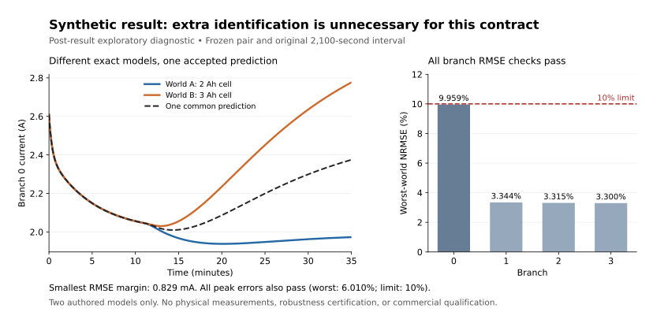

# Independent cell-to-pack experiment: executed numerical checkpoint

**The numerical instrument passes its implementation checks. The experiment has not established a new physical enabling capability, a cheaper accepted real-world route, or a profitable business.** One common prediction satisfies the original tolerances in both authored worlds, so the proposed necessity-of-additional-measurement claim fails for this finite task.

This independent experiment began from main `88ddcfa3745dd5ae3022b9224d151943c9489b10`. It compares consequential opportunities in materials, water measurement and heterogeneous battery qualification, then constructs a small decisive battery instrument. See [opportunity comparison](OPPORTUNITIES.md), [prospective registration](PREREGISTRATION.md) and [protocol facts](PROTOCOL_FACTS.md). Existing campaigns and accounts retain their original mandates and ownership.

## Executed result and decision

Stage B uses synthetic cell and pack equations, not measured batteries. Two candidate cells are indistinguishable in the registered short observations. Their later branch-current trajectories differ, but that difference does not make the stated prediction task impossible. A post-result exploratory diagnostic constructs the arithmetic midpoint of both candidate trajectories without receiving the actual-world identity. It meets every original branch RMSE and peak-current constraint in both worlds.



| Evidence | Result | Meaning |
| --- | --- | --- |
| Independent static circuit checks | 128 fixtures; maximum branch-current disagreement 3.39e-12 A | Constructor matches independently coded two-rail nodal equations on these fixtures |
| Complete-trace verification | Maximum disagreement 3.21e-6 A over registered refinements | Supports the numerical implementation, not physical model validity |
| Common midpoint prediction | Worst NRMSE 9.95853%; worst peak error 6.00977%; original limits 10% each | Acceptable in both frozen synthetic worlds |
| Smallest RMSE margin | 0.000829462 A below the 0.2 A limit | Very little margin; no robustness claim beyond this finite model set |
| Separating probe | 1,440 s at 1.5 A plus 300 s rest; predicted endpoint separation 11.1039 mV | Minimum within the 21-option separating menu; unnecessary for the common prediction |
| Simpler control | No-interconnect model passes recorded world-B tolerances with known world-B cell models | No demonstrated necessity or accepted-quality advantage for added interconnect detail in this fixture |
| Physical K1/K2, incumbent advantage, industry, revenue | Unestablished | No commercial deployment or profit claim is admitted |

The midpoint method was selected **after** observing Stage B. It is an explanatory diagnostic, not a prospective confirmation or a newly discovered general method. Established minimax reasoning explains its performance. More hypotheses, physical model error, another horizon or a different acceptance contract can invalidate it. The prior itself still requires construction and qualification.

The original [result](results/STAGE_B_RESULT.json) and [capability recommendation](results/CAPABILITY_ORIGINAL.json) are preserved. Read [claim corrections](CLAIM_CORRECTIONS.md) and the [current decision](results/CURRENT_DECISION.json): unconditional abstention is superseded only for this exact finite prediction contract. Physical operation remains unqualified. The [independent numerical review](INDEPENDENT_NUMERICAL_REVIEW.md) records the complete interpretation.

## Complete characterization burden

Retaining a long shared characterization stage can dominate the apparent saving from fewer pulse anchors. If F is shared burden and A is per-anchor burden, reducing ten anchors to four saves `6A/(F+10A)`. A 50% saving requires `F <= 2A`. At the explicitly assumed F=20 hours and A=1.04 hours, the saving is 20.5263%, before additional common costs. The twenty-hour case is a nominal-capacity scenario, not a measured universal lower bound for aged cells.

Actual acquisition durations, accepted physical accuracy, complete dollar costs and willingness to pay remain unknown. [Stage C](STAGE_C.md) proposes testing whether HPPC observations can remove the separate C/20 dependency, with strict information separation and abstention outside identified charge coverage. Its executable parser, exact file split and fit rules are **not yet frozen or evaluated**. A useful retained representation alone would not establish a new industry.

## Native cost accounts: conditional research loss

The existing `connected_enterprise.finance.JournalAccount` and mandatory adaptive account executed five **separate fresh equity hypotheses**. Four authored resource items cost $250 each; they are sensitivity inputs, not measured model billing, actual purchases, human wages or complete business costs. A $10,000 working reserve remains protected.

| Opening equity | Expense incurred | Closing cash | Available after reserve | Result |
| ---: | ---: | ---: | ---: | --- |
| $10,999 | $750 | $10,249 | $249 | Fourth $250 item refused |
| $11,000 | $1,000 | $10,000 | $0 | Four items funded |
| $100,000 | $1,000 | $99,000 | $89,000 | Four items funded |
| $1 million | $1,000 | $999,000 | $989,000 | Four items funded |
| $1 billion | $1,000 | $999,999,000 | $999,989,000 | Four items funded |

Every case has **zero revenue** and a loss equal to incurred research expense. This is a 24-hour modeled observation, not a completed trailing-365-day profit window. It establishes neither minimum viable business capital nor secured financing. Actual model/session costs and physical qualification, acquisition, insurance, deployment and other business costs remain unpriced. The $1 billion and $3 billion profit milestones are unachieved. No balances are pooled, no accounts are reset, and equity is never booked as revenue.

The cost envelope and artifact commitment were registered locally before account execution; this registration was not publicly timestamped before the run. See the [cost audit](PUBLIC_COST_AUDIT.md), [exact registration](results/RESEARCH_REGISTRATION.json), [producer audit](results/RESEARCH_ACCOUNT_AUDIT.json) and compressed complete key-free export `results/RESEARCH_ACCOUNT_PUBLIC.json.gz`. The export retains the native replay inputs; private recovery state is excluded. Reviewers share infrastructure, and the accounting reviewer authored the wrapper, so this is not external certification.

## Data and publication status

The selected physical source is [Piombo et al., Mendeley Data v2](https://data.mendeley.com/datasets/zh58byr53c/2), DOI 10.17632/zh58byr53c.2, CC BY 4.0. The [primary descriptor](https://pangea.stanford.edu/ERE/pdf/OnoriPDF/Journals/91.pdf) documents independently sensed cell currents. [Lone et al.](https://arxiv.org/html/2508.14454v1) provides a strong existing analytical pack-model comparator; its fitted parameter file cannot substitute for measured traces.

No physical measurement file was evaluated for the results above. See [acquisition history](ACQUISITION_HISTORY.md) and [bounded access alternatives](DATA_ACCESS_OPTIONS.md) for the exact access state. A successful numerical CI job is not evidence of physical data acquisition or scientific transfer. The numerical job at source `34b56f4052c7defaab4c18327f8051d60d4abe6b` passed in [run 41487782250](https://github.com/MontrealAI/AGI-Alpha-Invention-Flywheel-Lab/actions/runs/41487782250). The latest-head status must be checked separately.

The public work is [PR #147](https://github.com/MontrealAI/AGI-Alpha-Invention-Flywheel-Lab/pull/147). Publication of this checkpoint does not itself claim qualified merge, release or operation from a release.

The canonical package inventory now includes a fixed 39-member public closure through `release_inventory.py`. It rejects missing or linked members and ignores unlisted datasets, private state and caches. A three-line inventory hook leaves all 42 finance-bound source files and frozen scientific/accounting code unchanged. Twenty-nine relevant tests and the retained public-account replay passed from a fresh, extracted 98-file dependency closure. This focused local check does not substitute for the complete release gates. The campaign workflow now also qualifies relevant main pushes.

[Review PR #149](https://github.com/MontrealAI/AGI-Alpha-Invention-Flywheel-Lab/pull/149), commit `f926677385e22bef3ae7cb20a90446902fdb2596`, independently identified missing mandatory platform-start markers in both workflow jobs. Its workflow-only correction and known action pins have been incorporated into the combined candidate. The original failing runs remain failures; this is source adoption of a narrow repair, not a formal approval or a claim that the separate review branch passed all checks. Actual released-package inclusion and operation still require their own receipts.

## Reproduce from the repository root

Use Python 3.12 with NumPy 2.3.5, SciPy 1.17.0 and cryptography 50.0.2. Plotting additionally requires Matplotlib. Install dependencies in a suitable isolated environment; these commands create only local research outputs.

```sh
python -m unittest experiments.capability_transfer_20261102.test_instrument experiments.capability_transfer_20261102.test_catalog experiments.capability_transfer_20261102.test_economics experiments.capability_transfer_20261102.test_release_inventory -v

python -m experiments.capability_transfer_20261102.run_stage_b run \
  --freeze experiments/capability_transfer_20261102/FROZEN_STAGE_B_SERIALIZATION_FIX.json \
  --output /tmp/cell-pack-stage-b-new

python -m experiments.capability_transfer_20261102.run_midpoint_diagnostic \
  --result experiments/capability_transfer_20261102/results/STAGE_B_RESULT.json \
  --output /tmp/cell-pack-midpoint-new

python -m experiments.capability_transfer_20261102.plot_result \
  --traces /tmp/cell-pack-midpoint-new/midpoint_reference_traces.csv \
  --output /tmp/cell-pack-midpoint-new/midpoint.svg

gzip -dc experiments/capability_transfer_20261102/results/RESEARCH_ACCOUNT_PUBLIC.json.gz > /tmp/cell-pack-public-account.json
python -m experiments.capability_transfer_20261102.economics audit \
  --artifact experiments/capability_transfer_20261102/results/STAGE_B_RESULT.json \
  --public /tmp/cell-pack-public-account.json \
  --registration-sha256 e94112d4784abbd81af4ee277e5a12fe354d3237c79e887b90f379da3506bb5c
```

Use fresh output directories. A fresh Stage B run records fresh timings, so its whole-file hash differs from the retained original; the midpoint diagnostic deliberately binds to the original receipt. Its exact reference hashes also bind the numerical environment. No raw measurement dataset or reproducible trajectory bulk is committed. The compact [evidence manifest](results/MANIFEST.json) supplies retained artifact hashes.
