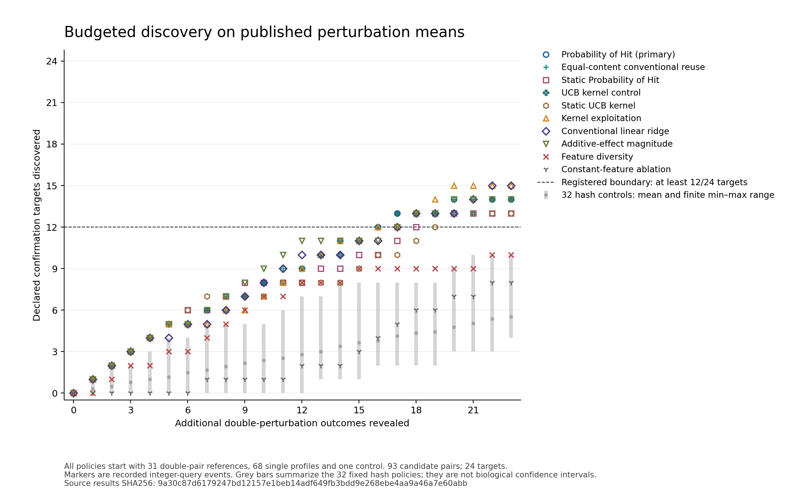

# NEXT072: a discovery-budget pass, with stronger conventional controls

**Admission decision:** accept the independently checked, source-bound research replay. The primary Probability-of-Hit policy found **14 of 24 declared targets in 23 queries**, meeting the registered requirement of at least 12. Its ordinary equal-content implementation tied exactly. Conventional linear ridge and kernel exploitation each found **15**, and simple additive-magnitude ranking also found **14**. This result does not establish an advantage for the full active-learning bundle, a newly missing productive capability, physical assay delivery or commercial entry. Preserve non-entry and the stronger simple comparators.

One registered measured-source execution and one independent verification were completed on 2 November 2026. There were no confirmation retries, source substitutions, altered targets or changes to the 24 frozen files. All **124,000 source rows, 124 pair lineages, 42 policies and 966 query records** were accounted for. The finite economic admission model returned **HOLD with 56 unknown inputs**; its separately scoped prospective experimental service was **REFUSE** because that service has not been qualified. No native financial trajectory ran.

Evidence: [constructor results](attempts/confirmation_001/results.json), [independent verdict](attempts/independent_001.json), [economic verdict](attempts/economic_001.json), and [independent execution receipt](attempts/independent_execution_001.json).

## What was selected, and what was rejected

The [complete-arrangement comparison](SELECTION.md) considered manufacturing qualification, combinatorial experiment allocation, methane mitigation verification and non-entry. The manufacturing candidate was rejected before a large test because a current complete fitting-free method already supplied the proposed generic predictor, and measured interface motion did not establish independent temperature truth. Methane intervention verification remained deferred for an unpinned independent intervention-truth and rights contract.

Current active-learning prior art also rejected the generic claim that joining a predictor to an experiment-selection loop creates a new capability. [NAIAD](https://proceedings.mlr.press/v267/qin25g.html) already supplies active combinatorial-perturbation design. [BATCHIE](https://doi.org/10.1038/s41467-024-55287-7) reports a prospective physical adaptive-screening arrangement. [Rubbi et al.](https://proceedings.mlr.press/v306/rubbi26a.html), section 4.1 and Algorithm 1, directly address discovery of many threshold hits. Their complete systems were not reimplemented or beaten here.

That review changed the unpublished draft primary from UCB to the purpose-matched Probability-of-Hit acquisition **before the public scientific freeze and before any source workbook retrieval**. UCB remained a control. The narrower construction asks whether six inexpensive, symmetric single-profile summaries plus counted reference experiments meet a fixed discovery budget on a published pair panel. It is a dependency investigation for a possible future unseen campaign, with an explicit stopping point.

## Frozen contract, source and denominator

The [preregistration](PREREG_K1.md), constructor, independent verifier, economic model, tests, plot source and dedicated workflow were publicly frozen at commit [`f987625eb06d82b9c630d5f4e6e1ff1ea0be75c6`](https://github.com/MontrealAI/AGI-Alpha-Invention-Flywheel-Lab/commit/f987625eb06d82b9c630d5f4e6e1ff1ea0be75c6). The coordinator re-fetched and byte-compared the public freeze before execution. `FREEZE.json` SHA256 is `35b1fc34346732c0966830ed34f505a6058c78252c253d0587fa6ae64afbacb0`.

The input is the author-exported `source_data/suppl-qqplot.xlsx` at [benchmark commit `bfa6eeea2bd145a1af2ec0127a2e808cc38456a9`](https://github.com/const-ae/linear_perturbation_prediction-Paper/tree/bfa6eeea2bd145a1af2ec0127a2e808cc38456a9), based on the Norman CRISPRa experiment. Retrieved bytes: **10,905,627**; Git blob: `f35c9efe3bf0f917068b2aaf2c2236b593c06e2c`; SHA256: `1b652c352d4dabdd20324d7fd74d331898fa22c51cf6fa28ff65aa1322a6c78f`. The source and license provenance are in [SOURCES.json](SOURCES.json) and [THIRD_PARTY_NOTICES.md](../../next072/THIRD_PARTY_NOTICES.md). The raw workbook is not republished.

For each pair, the target score is the RMS across 1,000 control-ranked readout genes of `AB-A-B+control`, using the published log-transformed expression means. The author code selects the gene panel from control expression, not the held-out double outcomes. The verifier independently checked all four mean fields and the residual. Maximum residual discrepancy was `2.6922908347160046e-15`; no invalid rows were dropped.

The pair population is experimentally enriched. The replay does not revalidate raw counts, normalization, log base, cell-level uncertainty or independent biological replication. A large RMS residual is the registered research-prioritization target; it is not a fitness effect, causal interaction mechanism, clinical endpoint or FDR-qualified discovery.

| Registered quantity | Observed value |
|---|---:|
| Complete double-pair lineages | 124 |
| Readout genes per pair | 1,000 |
| Initial reference pairs | 31 |
| Held-out candidate pairs | 93 |
| Top-quarter target pairs | 24 |
| Additional queries per policy | 23 |
| Batches per policy | 6 |
| Policies / total query receipts | 42 / 966 |

The 23 queries are 24.73% of the candidate pool. The primary's acquisition threshold was the fixed nearest-rank 75th percentile of initial reference scores: `0.11138588717206752` in source-expression units. It was never updated from confirmation outcomes. Gaussian exceedance scores are model acquisition scores, without a claim of calibrated biological probability. Pair lineages, rather than individual readout rows, define the split; shared constituent genes are allowed and explicitly enumerated in the independent verdict.

## Strongest result and strongest counterevidence

Every named policy used 23 additional queries and was scored against the same 24 targets. All 32 hash policies are included in the denominator and full [policy-results table](POLICY_RESULTS.csv).

| Policy | Targets found | Targets missed | Non-target queries | Target recall | Boundary |
|---|---:|---:|---:|---:|---|
| Probability of Hit — registered primary | 14 | 10 | 9 | 58.33% | Pass |
| Ordinary equal-content use | 14 | 10 | 9 | 58.33% | Pass; identical receipt |
| Static Probability of Hit | 13 | 11 | 10 | 54.17% | Pass |
| UCB kernel | 14 | 10 | 9 | 58.33% | Pass |
| Static UCB kernel | 13 | 11 | 10 | 54.17% | Pass |
| Kernel exploitation | 15 | 9 | 8 | 62.50% | Pass |
| Conventional linear ridge | 15 | 9 | 8 | 62.50% | Pass |
| Additive-effect magnitude | 14 | 10 | 9 | 58.33% | Pass |
| Feature diversity | 10 | 14 | 13 | 41.67% | Fail |
| Constant-feature PoH | 8 | 16 | 15 | 33.33% | Fail |
| All 32 hash controls | Mean 5.53125; range 4–10 | Mean 18.46875 | Mean 17.46875 | Mean 23.05% | 0/32 pass |

The primary exceeded the finite hash-control mean by 8.46875 discoveries, or 2.5311 times that mean. Removing its features reduced discoveries by six, and removing its outcome updates reduced discoveries by one in this fixed replay. Those descriptive differences are not biological effect estimates or physical error rates. The 32 hash orders are fixed controls over shared observations, not 32 independent experimental trials.

The complete bundle's necessity and superiority remain unsupported: static PoH already passes, additive ranking ties the primary, two conventional controls find one more target, and ordinary equal-content use is exactly identical. Additive ranking does not use reference D values, although this matched protocol charges all policies the common 31-reference setup. A complete conventional route could avoid that setup, but testing that choice requires a new preregistration. The registered 31-reference charges and denominator remain unchanged; no retroactive savings are claimed. This run therefore cannot support a full-cost advantage for the primary or an assertion that all its calibration and sequential feedback are needed.



The plot uses only recorded integer query events. Grey mean/range marks summarize the 32 fixed hash controls; they are not confidence intervals on biology. The frozen plotting code generated the [PNG](attempts/confirmation_001_figures/discovery_by_query.png), [SVG](attempts/confirmation_001_figures/discovery_by_query.svg) and [exact chart-source receipt](attempts/confirmation_001_figures/chart_source.json). The actual PNG was visually inspected. Results SHA256: `9a30c87d6179247bd12157e1beb14adf649fb3bdd9e268ebe4aa9a46a7e60abb`.

## Complete count, resources and economic admission

The counted setup and queries are **68 constituent single profiles + 1 control + 31 reference doubles + 23 selected doubles = 123 profiles per policy**. All pairs with these constituent singles would involve 193 profiles. This count is neither an equal-cost assay model nor a newly observed reduction in laboratory work. All outcomes were already public; a current buyer can download and analyze the complete workbook. **Actual new assays avoided by this replay: zero.**

The independent economic model includes a research buyer, analyst/operator, assay supplier, human specialist, rival and financier. Its six options include complete public self-service, full measurement, identical conventional automation, a correctly scoped analysis offer, a separately qualified prospective study and non-entry. It evaluates finite outside-option best responses and voluntary/cash-feasibility inequalities. Capital hypotheses of $0, $100,000 and $1 billion are crossed with payment after acceptance or a refundable deposit. None is received funding. Existing refund, collateral and warranty reserves remain protected from setup through the final modeled event; future collections cannot finance an earlier event.

The model returned **HOLD**, preserving 56 unknown monetary/acceptance inputs. Price, willingness to pay, missed-target losses, complete specialist attention, research/inference expense, assay costs, setup, remedies, financing terms, taxes and funding dates are not invented. Rival-cost sensitivities at 3, 6, 12, 18 and 24 months remain unresolved hypotheses. No supported equilibrium price, regret bound, complete-cost advantage, optimal capital or maximum cash shortfall can be reported from those unknowns. The experimental-allocation service remains unqualified and its service gate returns REFUSE; technical acceptance of this research report supplies no willing buyer. See [economic verdict](attempts/economic_001.json).

| Measured stage | Wall time | CPU time | Peak resident memory |
|---|---:|---:|---:|
| Registered constructor, including source retrieval | 8.464 s | 8.257 s | 100,264 KiB |
| Independent source/trace verification | 9.098 s | 9.254 s | 89,228 KiB |
| Economic admission evaluation | Not separately metered | Not separately metered | Not separately metered |

The constructor ran from `2026-11-02T20:45:53.863602Z` to `20:46:02.327961Z`; the independent audit finished at `20:46:21.400068Z`. Source retrieval was HTTP 200 in 0.583 seconds. These timings exclude total literature work, construction, failed metadata retrievals, coordinator review and included inference; they cannot be reported as complete production cost. No new paid resource, outside human/laboratory work, actual order, funding receipt or native collection was used. Included computation is not assumed economically free. [RESOURCE_COST_RECORD.json](RESOURCE_COST_RECORD.json) keeps measured quantities and unknowns separate.

## N1 and N2 finite dependency decisions

The complete N1/N2 assignments were declined after the [documented finite source investigation](DEPENDENCY_DECISIONS.md), without launching three independent construction teams.

For N1, the previously unavailable public supplement was successfully retrieved and its pages 7–8 visually checked. Table S1 supplies controller states and a product-totalizer pulse resolution of 1 pulse per 10 gallons; Figure S2 supplies unnumbered conductivity locations. The process-diagram numbers refer to valves, not the archive's conductivity channels. The archive's reported totalized-liter field still needs public PLC scaling provenance. A public tag dictionary, source-to-state/release binding, calibration/temperature basis and intended-use quality contract could change the HOLD. No new sensor-day outcomes were opened; W1's seven dates, three conditional quantity passes and seven quality HOLDs remain unchanged.

For N2, the inspected primary paper distinguishes measured fiber matrices from simulated reflector stacks. It does not provide the required independently validated complete calibrated inspection instrument through the inspected source route. The prior wrong-gain/nonreciprocity witnesses and complete probe lineage remain intact. An independently calibrated new observable with realistic access burden, or an independently specified consequential invariant purpose with reference truth, could reopen this route. Neither finite retrieval result proves physical impossibility.

## Stopping condition and next finite investment

The registered stage is complete: one source-bound replay, a passing independent audit, complete controls, an executed economic admission model and preserved artifacts. No favorable control replaced the primary. The broader flagship claim remains rejected by the complete prior art and lack of a concrete new qualification or affordability boundary. **Do not commit physical/commercial capital to this generic arrangement on these results.** Non-entry retains resources and obligations.

If this research dependency is pursued again, the next useful question is whether a simple additive or linear route meets a beneficiary-defined discovery requirement on a fresh independent panel under a **matched total acquisition/reference budget**, including repeated assays, batch failures and turnaround. Initial references that a method does not use must not be compulsory costs for that method. The new panel and acceptance rule must be frozen before inspection; this exposed panel cannot confirm tuning. Before promoting that into a flagship, identify the integration, qualification or complete-cost boundary that current complete systems do not already supply. A stronger unrelated productive arrangement remains eligible to displace this research stage.

The prospectively distinct fitness suppressor/rescue K2 is **not executed or accepted**. It needs separate fitness observations, intervention semantics, error/missed-rescue obligations and equal-content/no-inheritance controls. Transcript residuals cannot satisfy those requirements. There is no profitable cash-feasible native account to continue, no completed trailing-365-day financial window and no evidence for the $3 billion milestone.

## Reproduction and qualification status

The original invocation is preserved in [resource_receipt.json](attempts/confirmation_001/resource_receipt.json). For a later engineering reproduction, use a new output directory and the exact published source:

```bash
python -m pip install --only-binary=:all: -r requirements-next072.txt
python -m next072.freeze
python -m unittest next072.test_experiment next072.test_independent_verify tests.test_connected_platform_runtime064 -v
python -m next072.run --execution-kind engineering_reproduction --freeze f987625eb06d82b9c630d5f4e6e1ff1ea0be75c6 --download --workbook next072/downloads/reproduction-input.xlsx --output next072/downloads/reproduction-output
python -m next072.independent_verify --workbook next072/downloads/reproduction-input.xlsx --attempt next072/downloads/reproduction-output --freeze experiments/next_series_20261102/FREEZE.json --public-commit f987625eb06d82b9c630d5f4e6e1ff1ea0be75c6 --output next072/downloads/reproduction-verdict.json
python -m next072.economic_check --verification next072/downloads/reproduction-verdict.json --output next072/downloads/reproduction-economic.json
python -m next072.plot_results --attempt next072/downloads/reproduction-output --output next072/downloads/reproduction-figures
```

The prospective preflight passed **52/52** authored and runtime/workflow checks. Dedicated CI repeats are engineering reproductions of this same source and do not add biological observations or confirmations. [CI_STATUS.json](CI_STATUS.json) preserves the timestamped prepublication CI snapshot. Later source-matched CI status belongs to the public PR and final execution receipts; the historical snapshot is not rewritten to imply a pass it had not observed. A local or dedicated pass is not full repository qualification, merge or release. PR152 and its frozen scientific evidence were not modified by this stream.

The public [claim ledger](CLAIMS.json) and [learning registry](LEARNING_REGISTRY.json) retain the accepted scope, counterexamples, unknowns and next decisions.
