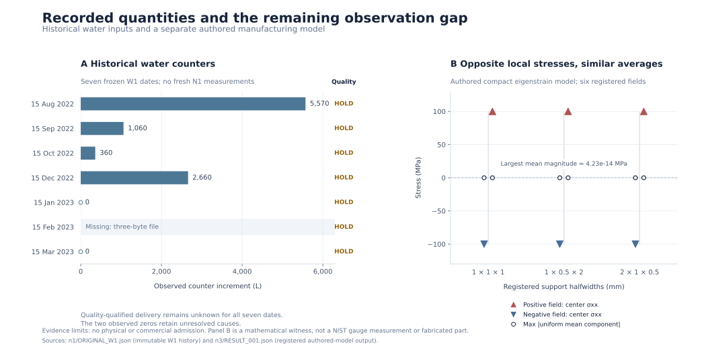

# Recorded-evidence figure



**Panel A:** Historical W1 daily counter increments retained in `n1/ORIGINAL_W1.json` at predecessor `a5df603854f98cbd673204258c8d768e0c759975`. All seven dates remain visible. February 15 is a three-byte missing source file, not zero production. January and March contain observed zero increments with unresolved causes. Every date remains quality HOLD. The plotted quantity is an archive counter increment; it is not independently qualified water delivery, a new N1 measurement or a seasonal-reliability estimate. The original three conditional quantity passes concern a separate stock calculation with cyclic storage.

**Panel B:** The six already-recorded spatial witnesses in `n3/RESULT_001.json`, grouped into three registered support-halfwidth triples. Filled triangles show the center sigma_xx values of the two authored fields, approximately -100 and +100 MPa. Open circles show each result's stored maximum absolute uniform-average stress component, approximately zero on this scale. The thin connector groups a pair; it is not a confidence interval. The largest stored mean magnitude is `4.2346307667015526e-14` MPa. These are authored compact eigenstrain-model results, not NIST gauge readings, empirical manufacturing errors or validation of a fabricated component.

The script reads the two existing JSON artifacts and renders their data. It imports no experiment constructor or runner, retrieves no new source and generates no test outcome. The display preserves the distinction between measured-input history and authored-model output. It claims no physical or commercial admission.

## Input identities

| Input | SHA256 |
|---|---|
| `n1/ORIGINAL_W1.json` | `c92e1c300edb14ba8651fa5d7d5e09435802ba8b687c709f3db906fc1c75404f` |
| `n3/RESULT_001.json` | `11125457ee08b4310b5cb24c2a0bc7417afcdcd7185197667b77d97545e8f13e` |

`chart_data.json` retains the exact plotted values, source row indices, input identities and display transformations. No missing observation is interpolated.

## Reproduce the display

```sh
python3 experiments/next_series_20261102_365c3d6c/charts/chart.py
```

Outputs: `recorded_evidence.svg` for the repository, `recorded_evidence.png` for visual inspection, and `chart_data.json` for exact data provenance. Python and matplotlib are required. Running this command regenerates only display artifacts in this directory.
