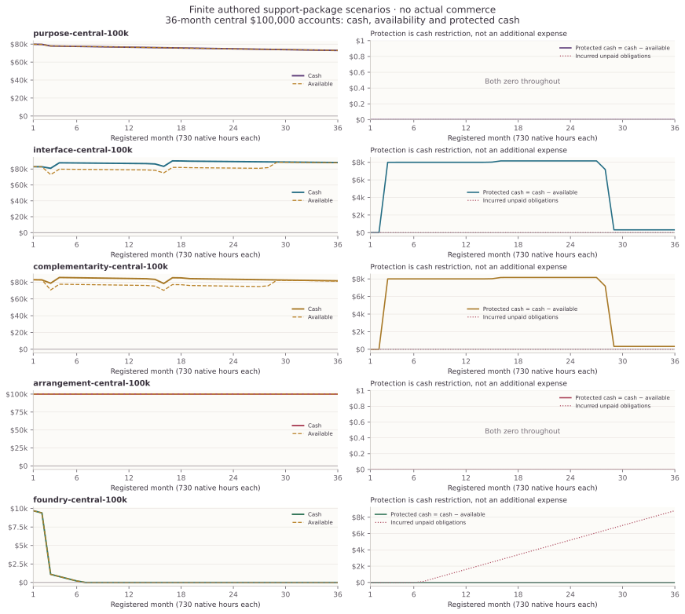
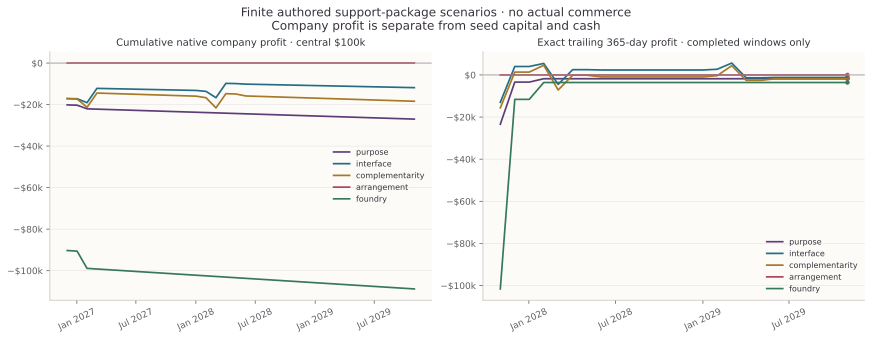
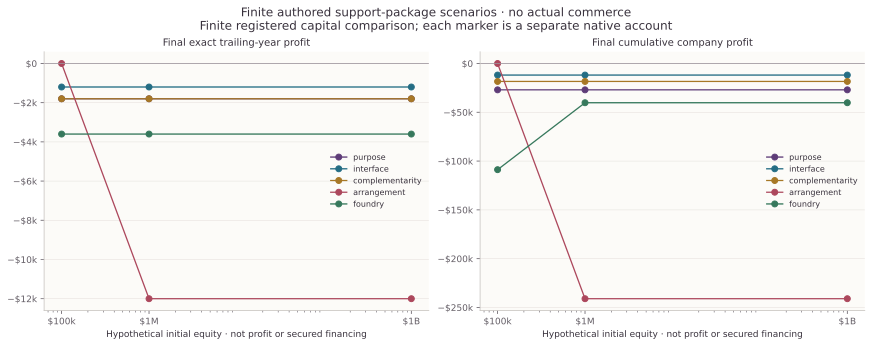
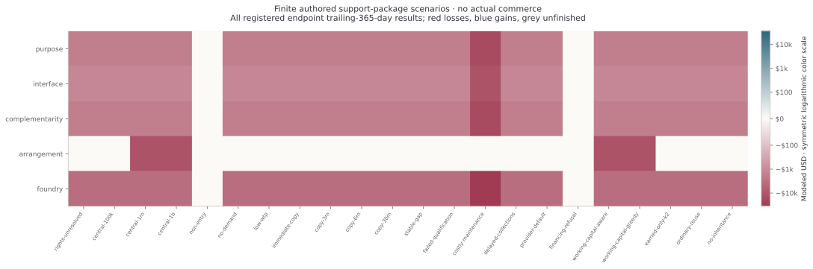

# AGI ALPHA: R2 complete finite comparison

110 of 110 registered, separately funded native scenarios are represented. These are hypothetical nonexclusive computational packages, checking and prepaid support. They establish no actual commerce, physical deployment, industry creation or measured human-productivity gain.

Each account has **8 authored prospects** and at most three scheduled purchase opportunities per buyer (initial K1, one renewal, K2). The largest registered posted price is $40,000, giving a loose **$960,000 gross-contract ceiling over all three years** per account. The registered $1B initial-equity comparison leaves demand unchanged. This small-market screen leaves the $3B scale path unidentified; zero attainment supplies no global business impossibility result.

The exact final operating window is **2028-11-01T00:00:00Z to 2029-11-01T00:00:00Z**, start inclusive and end exclusive. The 36 registered months contain 730 native hours each. Earlier short histories are not annualized; completed trailing-365-day observations begin only after a full year.

Best final trailing-year record: **purpose-non-entry**, $0. Worst: **foundry-costly-maintenance**, $-36,000. These are individual accounts, never pooled. Endpoint $1B milestone cases: 0; $3B milestone cases: 0.

## Central capital comparison

Each row is a distinct authored business/account. Initial equity, including $1B, is neither profit nor secured funding. Cumulative native company profit, exact final trailing-year profit and final cash are separate quantities. Cash restrictions are not charged again as expenses; post-operating settlements remain on the original account.

| Account | Initial equity | Cumulative company profit | Exact final 365-day profit | Cash | Available | Protected cash | Unpaid obligations | Collected orders |
|---|---:|---:|---:|---:|---:|---:|---:|---:|
| purpose-central-100k | $100,000 | $-27,000 | $-1,800 | $73,000 | $73,000 | $0 | $0 | 0 |
| purpose-central-1m | $1,000,000 | $-27,000 | $-1,800 | $973,000 | $973,000 | $0 | $0 | 0 |
| purpose-central-1b | $1,000,000,000 | $-27,000 | $-1,800 | $999,973,000 | $999,973,000 | $0 | $0 | 0 |
| interface-central-100k | $100,000 | $-11,848.8 | $-1,200 | $88,151.2 | $87,831.2 | $320 | $0 | 16 |
| interface-central-1m | $1,000,000 | $-11,848.8 | $-1,200 | $988,151.2 | $987,831.2 | $320 | $0 | 16 |
| interface-central-1b | $1,000,000,000 | $-11,848.8 | $-1,200 | $999,988,151.2 | $999,987,831.2 | $320 | $0 | 16 |
| complementarity-central-100k | $100,000 | $-18,399.2 | $-1,800 | $81,600.8 | $81,280.8 | $320 | $0 | 16 |
| complementarity-central-1m | $1,000,000 | $-18,399.2 | $-1,800 | $981,600.8 | $981,280.8 | $320 | $0 | 16 |
| complementarity-central-1b | $1,000,000,000 | $-18,399.2 | $-1,800 | $999,981,600.8 | $999,981,280.8 | $320 | $0 | 16 |
| arrangement-central-100k | $100,000 | $0 | $0 | $100,000 | $100,000 | $0 | $0 | 0 |
| arrangement-central-1m | $1,000,000 | $-241,000 | $-12,000 | $759,000 | $759,000 | $0 | $0 | 0 |
| arrangement-central-1b | $1,000,000,000 | $-241,000 | $-12,000 | $999,759,000 | $999,759,000 | $0 | $0 | 0 |
| foundry-central-100k | $100,000 | $-108,800 | $-3,600 | $0 | $0 | $0 | $8,800 | 0 |
| foundry-central-1m | $1,000,000 | $-40,203.2 | $-3,600 | $959,796.8 | $956,596.8 | $3,200 | $0 | 16 |
| foundry-central-1b | $1,000,000,000 | $-40,203.2 | $-3,600 | $999,959,796.8 | $999,956,596.8 | $3,200 | $0 | 16 |

## Non-entry and rights controls

Non-entry and licensing refusal are valid outcomes. Rights-qualified central arms are counterfactual assumptions, not legal clearance; public source availability does not supply commercial rights.

| Account | Initial equity | Cumulative company profit | Exact final 365-day profit | Cash | Available | Protected cash | Unpaid obligations | Collected orders |
|---|---:|---:|---:|---:|---:|---:|---:|---:|
| purpose-non-entry | $100,000 | $0 | $0 | $100,000 | $100,000 | $0 | $0 | 0 |
| purpose-rights-unresolved | $100,000 | $-25,400 | $-1,800 | $74,600 | $74,600 | $0 | $0 | 0 |
| interface-non-entry | $100,000 | $0 | $0 | $100,000 | $100,000 | $0 | $0 | 0 |
| interface-rights-unresolved | $100,000 | $-20,600 | $-1,200 | $79,400 | $79,400 | $0 | $0 | 0 |
| complementarity-non-entry | $100,000 | $0 | $0 | $100,000 | $100,000 | $0 | $0 | 0 |
| complementarity-rights-unresolved | $100,000 | $-22,400 | $-1,800 | $77,600 | $77,600 | $0 | $0 | 0 |
| arrangement-non-entry | $100,000 | $0 | $0 | $100,000 | $100,000 | $0 | $0 | 0 |
| arrangement-rights-unresolved | $100,000 | $0 | $0 | $100,000 | $100,000 | $0 | $0 | 0 |
| foundry-non-entry | $100,000 | $0 | $0 | $100,000 | $100,000 | $0 | $0 | 0 |
| foundry-rights-unresolved | $100,000 | $-100,800 | $-3,600 | $0 | $0 | $0 | $800 | 0 |

**Funding failures remain visible:** 23 reported accounts have account_summary_covered=false. Their incurred obligations remain expenses, and their unpaid amounts are retained in CLAIMS.json; native arithmetic acceptance does not turn them into funded success.

## Histories and finite frontier









Every negative result remains represented. The frontier compares existing native records across registered capital/strategy/world combinations, including non-entry. It is not a causal ranking between changed worlds, an investor commitment, a new ledger or a globally optimal enterprise. Exact monetary values and all case identities are retained in the claims file.

## Evidence and remaining limits

R1's 25-case prefix remains preserved with failed executable source-closure qualification. R2 is a separately qualified-source engineering reproduction of the original authored financial comparisons; no R1 cash, obligations or account authority was imported, and it is not new blinded market calibration.

This report reads only public R2 records and copies the native observer. Producer audit acceptance is not a replacement for the separately required independent replay. SourceDataSummary records every read file and SHA-256 in the claims file. The scientific limits of all five original routes remain unchanged. Prices, demand, competition, rights clearance, cost profiles and tax treatment are authored scenario inputs; actual host/model billing remains unknown. No revenue is inferred from scientific novelty, valuation, financing proceeds or customer value.

Reproduce from a complete public evidence directory:

```bash
python experiments/public_portfolio_20261102/reporting/generate.py --public /absolute/path/public --output /absolute/path/report
```
