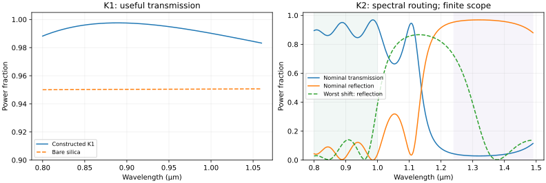

# Foundry route: computational transfer passed; discovery advantage failed

The registered construction produced an accepted near-infrared antireflection design and two accepted fresh two-band spectral-routing designs. Equal-content ordinary reuse and the ordinary optimizer without a claimed discovery procedure tie exactly; an independently implemented fresh specialist ties to floating-point precision. This establishes a useful bounded computational instrument and transfer to a different function, while leaving the newly attainable industry/stronger-inventor claim unsupported. No physical coating or market transaction was produced.

Scientific source and protocol were frozen by the coordinator in commit `211963d53628604482e66a34deba384c581cf684`, based on main `a842861dcf532ee8b769f39248c4c1faabfb628a`. Preregistration SHA-256 is `c3393cdaed76cdf72b1f0ebdfaac7122c23c85f573075e0929f809642011abad`. One confirmation ran, with no scientific-source changes or favorable-seed reruns. Full exact source identities, designs, finite acceptance worlds and resource measurements are in [results/RESULTS.json](results/RESULTS.json).

| Actual computational artifact | Frozen acceptance | Observed worst finite-world band mean | Verdict |
| --- | --- | --- | --- |
| K1: two-layer antireflection entrance coating, 0.8–1.06 um | Useful transmission at least 0.975 | 0.9923216233 | Accepted within specified model |
| K2-A: 12-layer two-band router | Pass transmission and stop reflection each at least 0.80 | 0.8981532481 transmission; 0.8609059129 reflection | Accepted within specified model |
| K2-B: shifted-band 12-layer router | Same thresholds; bands shifted -0.025 um | 0.9000425685 transmission; 0.8617930523 reflection | Accepted within specified model |

Each nominal acceptance checks 18 angle/polarization/manufacturing worlds. The tabulated quantities are wavelength means, not pointwise guarantees, continuous uncertainty bounds or measured device yield. The fresh function routes two spectral bands differently; K1 only maximizes entrance throughput. Greater downstream consequence is a motivated application hypothesis, not a measured increase in industrial output.

The nominal illustrations use 30-degree s polarization. The right panel also shows the registered worst manufacturing/angle shift's reflection; shaded regions are the accepted pass/stop bands. The complete finite-world means, rather than the illustration, determine acceptance. These plots come from the accepted designs and can be regenerated using `plot_results.py`.

## What transferred and what did not

K1 retained the source-bound optical forward kernel, material provenance, scope and ordinary robust search procedure. K2 constructs new thicknesses for a different function and new bands, without importing K1 optimum thicknesses. The manifest explicitly withholds physical qualification, buyer consent, funding and future truth. Neither K2 task is represented as a hidden new physical measurement: they are prospectively fixed computational requirements. The independently owned verifier supplies additional adversarial tests.

On each K2 task, retained, ordinary equal-content reuse and equal-content without a special discovery procedure use 1,968 objective evaluations each. Their objective and quality match exactly. The fresh specialist uses the same public constants and finite search budget but a separate scattering propagation kernel; it reaches the same accepted quality. This comparator shares ordinary input/Snell-law helpers, not the candidate's characteristic propagation. Fresh software-authoring effort was not measured; no fictitious salary or reconstruction-time advantage is assigned.

Bare silica fails both K2 contracts: long-band reflection is only 0.0332686888 and 0.0333035230. This supports the need for an optical stack relative to a bare substrate, while the strong conventional route already supplies that stack. Consequently the bare-substrate gain cannot establish a residual beyond competent complete alternatives.

Both registered distribution shifts—up to 10% common thickness error and 35/40/45-degree incidence—fail unchanged performance. Worst band means fall to 0.2218589566 and 0.2355407746. No retuning hides these failures. A deployment request outside the admitted envelope must be refused or separately requalified; nominal acceptance does not transfer as a universal certificate.

## Scientific verification and costs

The largest characteristic/scattering/boundary-system discrepancy is `6.661338147750939e-15`. K1 absorption remains positive, with a minimum of `0.0007587504822034186`; Ta2O5 loss is retained rather than converted into useful output. Bare-interface Fresnel, one-layer quarter-wave and eight malformed/out-of-envelope rejection controls pass. These check the equations/code under shared modeling assumptions; common material error, anisotropy, temperature, roughness, adhesion and manufacturing lifetime remain outside validation.

The complete once-only route used **73.3027 CPU seconds**, **73.3933 wall seconds** and **63,696 KiB peak RSS** on the current environment. This measures numerical execution only. Research/source reading, included reasoning and source authoring were not billed or timed as industrial operations. Actual model/host bills and user oversight time are unknown. No extra purchase, paid model call, external contact or physical operation occurred. The route requested zero minutes of internal human assistance; this does not turn unmeasured user oversight into zero labor or prove a fully autonomous deployed laboratory.

[ECONOMIC_INPUTS.json](ECONOMIC_INPUTS.json) provides explicit, uncalibrated offering/cost/lead-time/financing scenarios for the coordinator's canonical-account comparisons. The offering is a qualified design plus separately purchased prototype/metrology, with competent in-house engineering and standard filters as outside options. Neither optical improvement nor a cited energy application establishes willingness to pay. No conditional profit value is manufactured by this route, no alternate ledger is created, and no USD 3 billion annual-profit claim follows. Physical manufacture requires a separately costed qualified facility or supplier; it is not free capacity inside software licensing.

| Claim | Status | Evidence or remaining condition |
| --- | --- | --- |
| Executable computational instrument and artifacts | Supported, bounded | Frozen source, three actual designs, finite acceptance and equation checks |
| Fresh different-function capability transfer | Supported, model conditional | New two-band objective and designs use retained kernel |
| Improved discovery beyond equal-content reuse | Failed in this comparison | Exact ordinary-reuse ties and fresh-specialist tie |
| Newly attainable productive frontier beyond strong complete alternatives | Not established | Existing full thin-film routes already allow these means; no evidence-bounded new economic threshold |
| Physical device performance | Unresolved | Fabrication and independent film/device metrology absent |
| Human-baseline productivity | Unresolved | Competent automated conventional design allowed; no timed complete human campaign observed |
| Strict autonomous industrial operation | Unresolved | No laboratory operation; oversight and necessary deployment review unmeasured |
| Conditional complete-cost profitability or funded successor | Coordinator-owned, separate | Must use registered native accounts, full liabilities and voluntary choice |
| Actual revenue, funding or USD 3 billion trailing-year profit | Not established | No commerce or secured funding |

## Retained lesson and next decisive construction

Tried ordinary robust optics plus a retained source-bound kernel; both fresh spectral functions were accepted, while ordinary tools tied and a wider manufacturing envelope failed. Keep the valid computational instrument and its narrow context contract. Avoid calling source reuse an improved inventor or a narrow optical component a new energy industry.

The next physical discriminating construction is a fabricated coating characterized by independently acquired ellipsometry/spectral measurements, with held-out deposition and temperature changes. That work is outside this assignment's physical-operation/spending authority and cannot be replaced by another favorable numerical seed. Before any such deployment, compare the actual installed instrument and complete contract against existing coating houses/standard designs and measure the supported economic threshold. In the current environment, the accepted kernel and explicit failure boundary remain useful qualified inputs for other computational constructions; no standing AGENTS superiority rule is earned by these ties.
